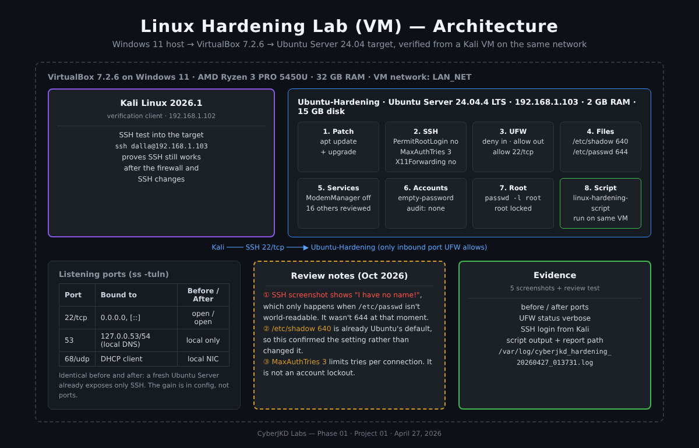
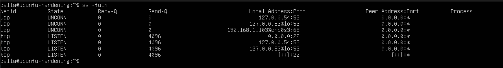
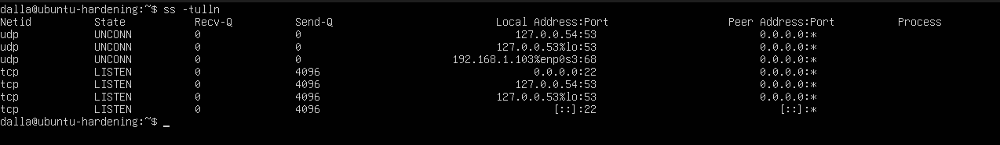
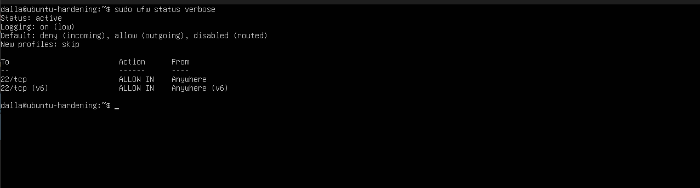
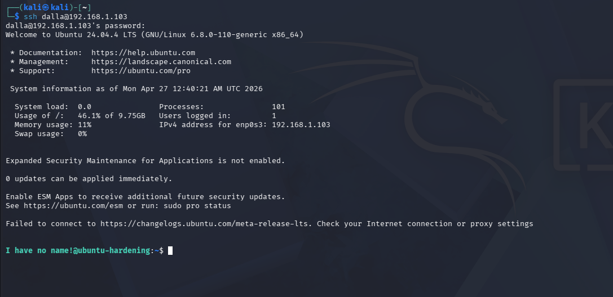
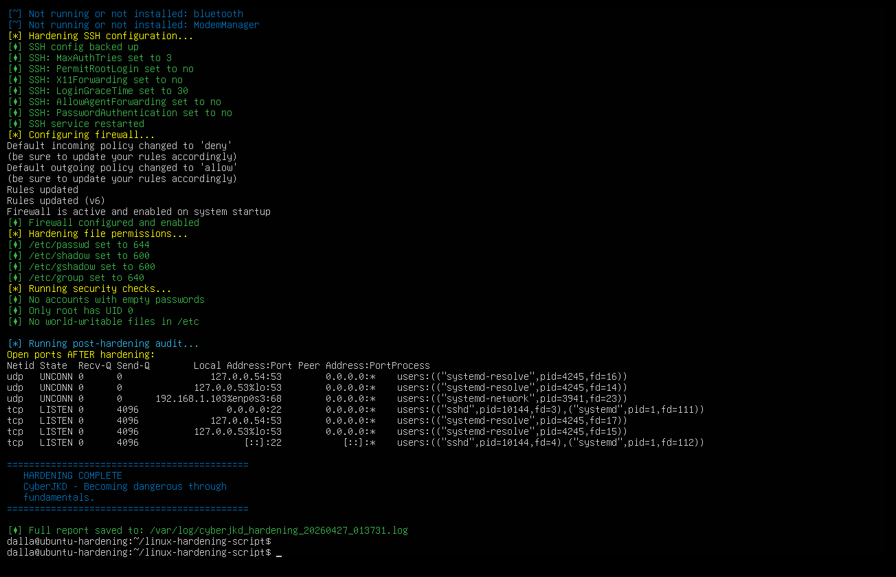
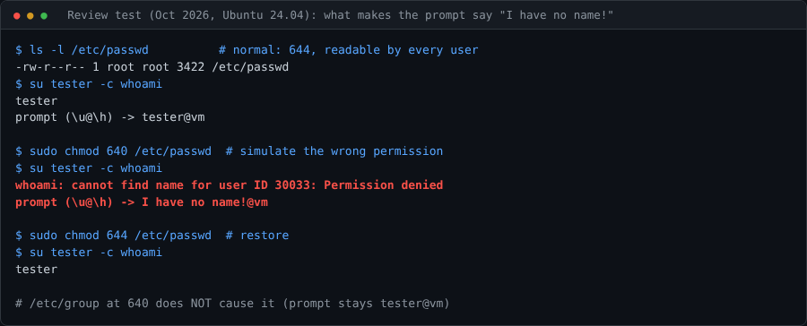

# Linux Hardening Lab (VM) - Ubuntu Server 24.04 on VirtualBox


| | |
|---|---|
| **Author** | Dalla Samuel (CyberJKD) |
| **Date** | April 27, 2026 |
| **Platform** | VirtualBox 7.2.6 · Windows 11 · AMD Ryzen 3 PRO 5450U · 32 GB RAM |
| **Roadmap** | Phase 01 · Project 01 ✅ (VM redo, final) |
| **Builds on** | [linux-hardening-lab](https://github.com/DallaSamuel/linux-hardening-lab) (Kali on WSL2) · [linux-hardening-script](https://github.com/DallaSamuel/linux-hardening-script) |

---

## Objective

Manually harden a fresh Ubuntu Server 24.04 VM, applying security controls step by step. Verify each control works. Document the before/after state as evidence. Then run the [linux-hardening-script](https://github.com/DallaSamuel/linux-hardening-script) automation on the same VM.

## Business Problem

My first hardening lab ran on Kali inside WSL2, which is a desktop sub-system, not a server. Real hardening work happens on servers that other machines connect to over a network. This redo uses a real Ubuntu Server VM on its own network, and checks the result from a **second machine** (Kali). That is how an admin proves a server is locked down *and* still reachable for the people who need it.

## Environment

| VM | OS | RAM | Disk | Network / IP |
|---|---|---|---|---|
| Ubuntu-Hardening (target) | Ubuntu Server 24.04.4 LTS | 2048 MB | 15 GB | LAN_NET · 192.168.1.103 |
| Kali (verification client) | Kali Linux 2026.1 | - | - | LAN_NET · 192.168.1.102 |

**Tools & software:** VirtualBox 7.2.6, Ubuntu Server 24.04.4 LTS, UFW, OpenSSH Server, Kali Linux 2026.1, [linux-hardening-script](https://github.com/DallaSamuel/linux-hardening-script)

## Key Concepts

- **Patch before hardening**: updating first removes known vulnerabilities before any config work starts.
- **SSH hardening**: `PermitRootLogin no` removes direct root login entirely (`prohibit-password` still allowed root with a key). `MaxAuthTries 3` caps password guesses per connection.
- **Default-deny firewall**: UFW blocks all inbound traffic except what is explicitly allowed (SSH on 22/tcp).
- **Least privilege on account files**: `/etc/shadow` (password hashes) is readable only by root and the `shadow` group. `/etc/passwd` must stay readable by everyone because the system uses it to turn user IDs into names.
- **Locking root**: `passwd -l root` disables password login for the root account itself, on top of the SSH setting.
- **Verify from outside**: a control isn't proven until it's tested from another machine.

## Architecture



```
Windows 11 host (AMD Ryzen 3 PRO 5450U, 32 GB RAM)
   │
   ▼
VirtualBox 7.2.6 ── network: LAN_NET
   ├── Kali Linux 2026.1 (192.168.1.102)   → verification client
   │        │
   │        └── ssh dalla@192.168.1.103 ──▶ 22/tcp (only port UFW allows inbound)
   │
   └── Ubuntu-Hardening, Ubuntu Server 24.04.4 LTS (192.168.1.103) → target
            ├── 1. Patch       → apt update + upgrade
            ├── 2. SSH         → PermitRootLogin no · MaxAuthTries 3 · X11Forwarding no
            ├── 3. UFW         → deny incoming · allow outgoing · allow 22/tcp
            ├── 4. Files       → /etc/shadow 640 · /etc/passwd 644
            ├── 5. Services    → ModemManager disabled · 16 others reviewed
            ├── 6. Accounts    → empty-password audit (none found)
            ├── 7. Root        → passwd -l root
            └── 8. Automation  → linux-hardening-script run on the same VM
```

---

## Hardening Steps Applied

### 1. System Update

Updated all packages to the latest versions before hardening, so no known (already-patched) vulnerabilities remain before the controls are applied.

### 2. SSH Hardening

- `PermitRootLogin` → changed from `prohibit-password` to `no` (full lockdown)
- `MaxAuthTries` → `3` (limits password guesses per connection)
- `X11Forwarding` → `no` (disables unnecessary graphical forwarding)

### 3. Firewall Configuration (UFW)

- Default incoming policy → `deny`
- Default outgoing policy → `allow`
- Port 22 (SSH) explicitly allowed
- All other inbound traffic blocked

### 4. File Permissions

- `/etc/shadow` → `640` (password hashes unreadable by non-root users)
- `/etc/passwd` → `644` (readable by the system, writable only by root)

### 5. Disable Unnecessary Services

- Disabled `ModemManager`, which is irrelevant on a server with no modem
- All other 16 running services confirmed as legitimate system services

### 6. Empty Password Audit

- Ran an `awk` check against `/etc/shadow`
- No accounts with empty passwords found ✅

### 7. Root Account Locked

- Root password login disabled with `passwd -l root`
- Root cannot log in directly even with the correct password

## Command Reference

```bash
# 1. Patch
sudo apt update && sudo apt upgrade -y

# 2. SSH: edit /etc/ssh/sshd_config, then check and apply
sudo nano /etc/ssh/sshd_config          # PermitRootLogin no · MaxAuthTries 3 · X11Forwarding no
sudo sshd -t && sudo systemctl restart ssh
sudo sshd -T | grep -Ei 'permitrootlogin|maxauthtries|x11forwarding|passwordauthentication'

# 3. Firewall (allow SSH BEFORE enabling, or you lock yourself out)
sudo ufw default deny incoming
sudo ufw default allow outgoing
sudo ufw allow 22/tcp
sudo ufw enable
sudo ufw status verbose

# 4. File permissions
sudo chmod 640 /etc/shadow
sudo chmod 644 /etc/passwd
ls -l /etc/shadow /etc/passwd

# 5. Services
systemctl list-units --type=service --state=running
sudo systemctl disable --now ModemManager

# 6. Empty passwords
sudo awk -F: '($2 == "") {print $1}' /etc/shadow

# 7. Lock root
sudo passwd -l root
sudo passwd -S root          # shows "L" when locked

# Ports before / after
ss -tuln
```

---

## Verification Tests

### Before Hardening - Open Ports



*`ss -tuln` baseline: SSH on 22/tcp (IPv4 + IPv6), local DNS on 127.0.0.53/54:53, and the DHCP client on 192.168.1.103:68.*

### After Hardening - Open Ports



*Post-hardening scan: identical. A fresh Ubuntu Server already listens on very little, so the hardening changed **configuration** (SSH, firewall, accounts) rather than open ports. No new attack surface was introduced.*

### Firewall Status



*`ufw status verbose`: active, logging on (low), default deny incoming / allow outgoing, only 22/tcp allowed (IPv4 and IPv6).*

### SSH Verification from Kali



*SSH from Kali (192.168.1.102) to Ubuntu-Hardening (192.168.1.103) succeeded through the firewall. The prompt reads `I have no name!@ubuntu-hardening`, which points to a permission problem on `/etc/passwd` at that moment (see [Review Note 1](#review-notes-october-2026)).*

---

## Automation Script

After the manual hardening, the automation script from [linux-hardening-script](https://github.com/DallaSamuel/linux-hardening-script) was deployed and run on the same VM.

The script performed all hardening steps in a single run:

- Disabled unnecessary services automatically
- Hardened SSH configuration (adds `PasswordAuthentication no`, `LoginGraceTime 30`, `AllowAgentForwarding no`)
- Configured the UFW firewall
- Set file permissions
- Ran security checks: empty passwords, UID 0 audit, world-writable files
- Generated a timestamped report: `/var/log/cyberjkd_hardening_20260427_013731.log`

### Script Output



*Full automated run ending in "HARDENING COMPLETE - CyberJKD - Becoming dangerous through fundamentals." The post-hardening audit shows only `sshd` (22/tcp) listening on the network.*

> The script was later re-tested on a fresh Ubuntu 24.04 system and has documented findings of its own (SSH settings can be overridden by cloud drop-in files, `/etc/group` set to 640, failures reported as success). See [linux-hardening-script → Findings](https://github.com/DallaSamuel/linux-hardening-script#findings).

## Verification Checklist

- [x] Packages updated before hardening
- [x] `PermitRootLogin no`, `MaxAuthTries 3`, `X11Forwarding no` set
- [x] UFW active: deny incoming, allow outgoing, only 22/tcp allowed
- [x] `/etc/shadow` 640 and `/etc/passwd` 644 set
- [x] `ModemManager` disabled; 16 remaining services reviewed
- [x] No accounts with empty passwords
- [x] Root account locked with `passwd -l root`
- [x] No new listening ports after hardening (`ss -tuln` before = after)
- [x] SSH from Kali still works through the firewall
- [x] Automation script run on the same VM, report saved to `/var/log/`

## What Threat Does This Defend Against?

An unhardened server reachable over the network gives an attacker easy options: guess passwords over SSH, try to log in as root directly, or reach services that should never have been exposed. These controls remove those options:

- **Root login blocked**: `PermitRootLogin no` over SSH, plus root's own password locked
- **Password guessing slowed**: `MaxAuthTries 3` drops a connection after 3 failed attempts
- **Firewall denies all unexpected inbound traffic**: only SSH is reachable
- **Password hashes protected**: `/etc/shadow` readable only by root and the `shadow` group

## Review Notes (October 2026)

I came back to this lab after later projects and reviewed it the way I'd review someone else's work. The hardening results stand. These notes add precision.

**1. The SSH screenshot shows a broken user lookup.** The prompt after logging in from Kali reads **`I have no name!@ubuntu-hardening`**. Bash prints that when it can't turn the user's ID into a name, which happens when the user isn't allowed to read `/etc/passwd`. I reproduced it on a fresh Ubuntu 24.04: with `/etc/passwd` at 644 the prompt is normal, and with 640 or 600 it becomes `I have no name!`. Changing `/etc/group` does not cause it. So at the moment of the SSH test, `/etc/passwd` was **not** 644, possibly from a `chmod` meant for `/etc/shadow` landing on `/etc/passwd`. The script run about an hour later sets `/etc/passwd` to 644, which would have fixed it. **Lesson:** after changing permissions on account files, run `ls -l /etc/passwd /etc/shadow` and log in as a normal user to confirm nothing broke.



**2. `/etc/shadow` 640 is already the Ubuntu default.** Ubuntu ships `/etc/shadow` as 640 `root:shadow`, so a fresh install doesn't expose password hashes to normal users. Step 4 *confirmed* the secure setting rather than fixing a weak one. Checking and recording it is still worth doing, because a misconfigured server might not be at the default.

**3. `MaxAuthTries` is not an account lockout.** It closes a connection after 3 failed attempts, but an attacker can simply reconnect and keep guessing. A real lockout needs `fail2ban` (which bans the source IP) or PAM `faillock`. Key-only login (`PasswordAuthentication no`) removes password guessing entirely, and the automation script adds that.

**4. Password login was still on during the manual test.** The Kali screenshot shows a password prompt (`dalla@192.168.1.103's password:`), which matches the manual steps: `PasswordAuthentication` wasn't changed until the script ran. The best final proof is `sudo sshd -T | grep passwordauthentication` on the VM, plus a key-based login from Kali.

## What I'd Change for Production

- **Key-only SSH** (`PasswordAuthentication no`) with keys set up and tested *before* turning passwords off.
- **Real brute-force protection** with `fail2ban` or PAM `faillock`, on top of `MaxAuthTries`.
- **Restrict SSH by source**: `ufw allow from <admin-subnet> to any port 22` instead of from anywhere.
- **Verify effective config**: `sshd -T` for SSH, `ls -l` plus a normal-user login after any permission change (Review Note 1).
- **Automatic security updates** with `unattended-upgrades`, so patching doesn't depend on someone remembering.
- **Benchmark it**: run Lynis or a CIS Ubuntu 24.04 benchmark scan before and after to measure the improvement.
- **Central logging**: forward `auth.log` to a SIEM. That's done in the [Splunk SIEM lab](../../phase-02/project-01-splunk-siem-lab).

## Lessons Learned

- Always patch first before hardening. It removes known vulnerabilities immediately.
- SSH must be explicitly allowed in UFW **before** enabling the firewall, or you lock yourself out.
- `prohibit-password` restricts root SSH login but `no` fully disables it. Always use `no`.
- Restart SSH after config changes or the new settings don't apply. Run `sshd -t` first to catch typos.
- `passwd -l` locks root. That's the letter **l**, not the number 1.
- A clean Ubuntu Server 24.04 install runs very few unnecessary services by default.
- *(Added on review)* A strange prompt like `I have no name!` is evidence too. Check it instead of moving past it.

## Connection to Roadmap

**Phase 01 · Project 01** of the [CyberJKD Roadmap](https://dallasamuel.github.io/CyberJKD-Roadmap). This is the final version of my first hardening project:

1. [linux-hardening-lab](https://github.com/DallaSamuel/linux-hardening-lab): Kali Linux on WSL2 (March 14, 2026)
2. [linux-hardening-script](https://github.com/DallaSamuel/linux-hardening-script): the checklist automated (March 23, 2026)
3. **This lab**: a real server VM, verified from a second machine, with the script deployed (April 27, 2026)

## References

- [CyberJKD Roadmap](https://dallasamuel.github.io/CyberJKD-Roadmap/)
- [Ubuntu Server Security](https://ubuntu.com/security)
- [UFW Documentation](https://help.ubuntu.com/community/UFW)
- [OpenSSH sshd_config manual](https://man.openbsd.org/sshd_config)

---

🌐 Full roadmap: [dallasamuel.github.io/CyberJKD-Roadmap](https://dallasamuel.github.io/CyberJKD-Roadmap)

🔗 All labs: [github.com/DallaSamuel/CyberJKD-Labs](https://github.com/DallaSamuel/CyberJKD-Labs)

---

*CyberJKD - Becoming dangerous through fundamentals. 🔒*
