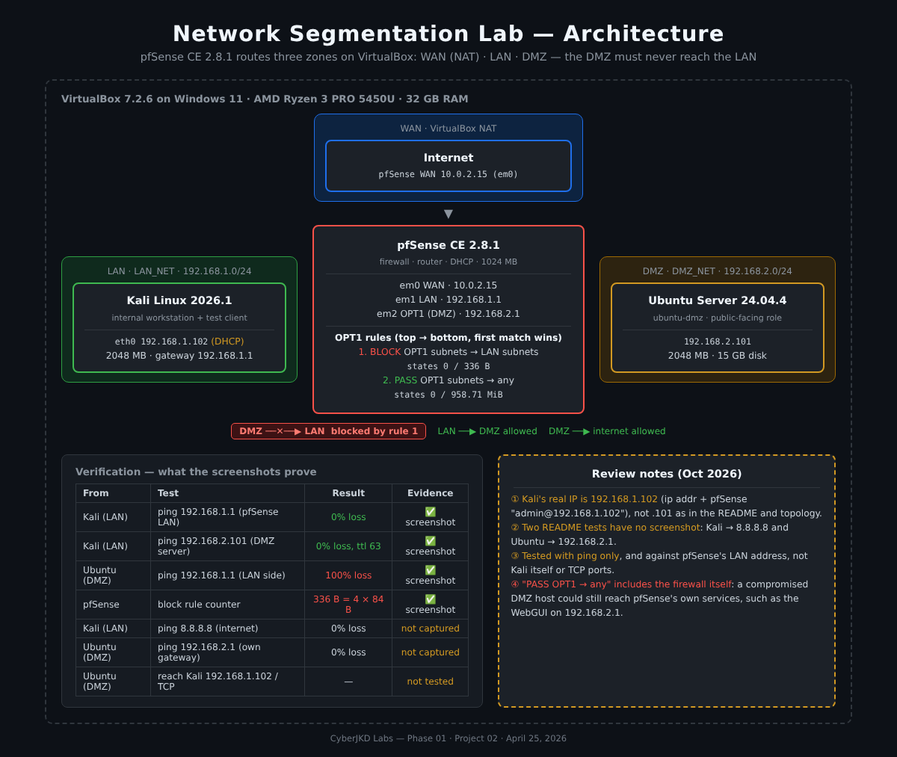
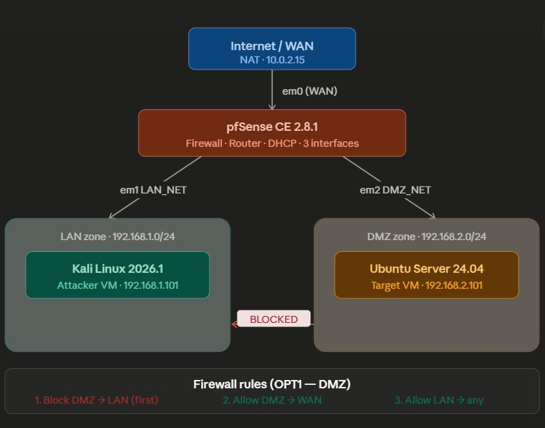
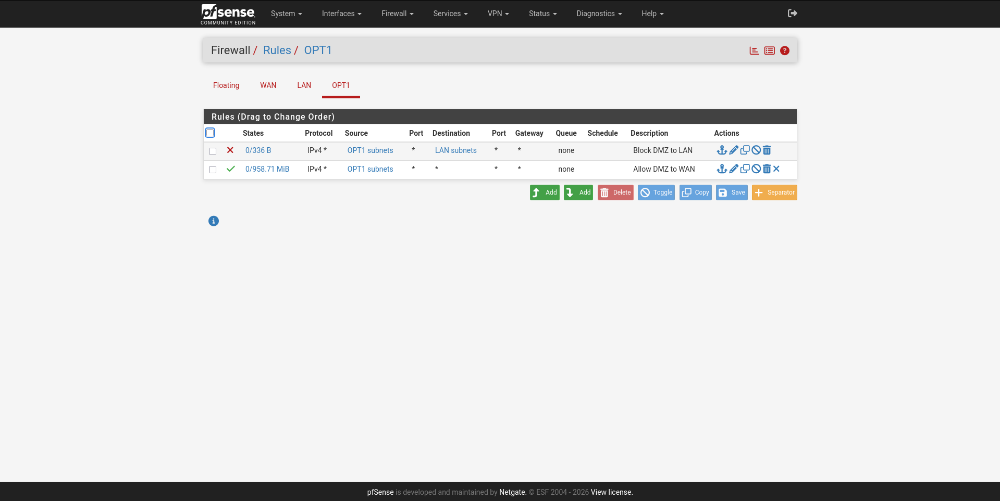
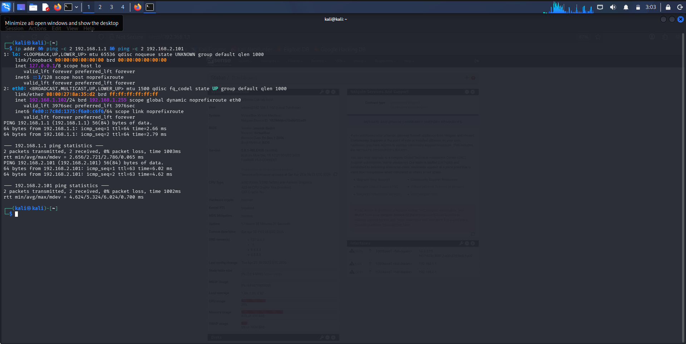
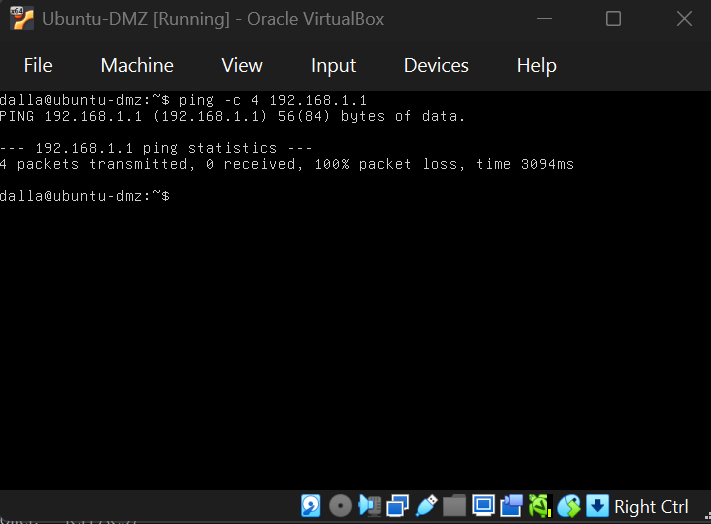
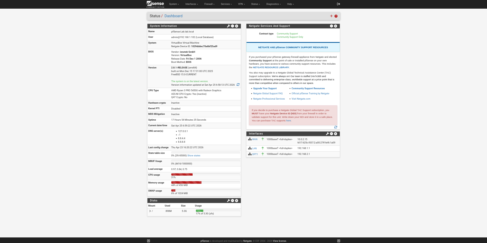

# Network Segmentation Lab - pfSense LAN / DMZ Isolation


| | |
|---|---|
| **Author** | Dalla Samuel (CyberJKD) |
| **Date** | April 25, 2026 |
| **Platform** | VirtualBox 7.2.6 · Windows 11 · AMD Ryzen 3 PRO 5450U · 32 GB RAM |
| **Roadmap** | Phase 01 · Project 02 |

---

## Objective

Design and build a segmented network with pfSense as the firewall/router: a **LAN** zone for an internal machine (Kali) and an isolated **DMZ** zone for a server (Ubuntu). Then verify that the firewall rules stop lateral movement from the DMZ into the LAN.

## Business Problem

Organizations put public-facing servers (websites, mail, file transfer) in a **DMZ**, a separate network zone, because those servers are the most likely to be compromised. If a DMZ server is breached and nothing separates it from the internal network, the attacker can move sideways to workstations, file servers and domain controllers. Segmentation with a default-deny rule between zones contains a breach to the zone where it happened.

## Environment

| VM | Role | RAM | Disk | VirtualBox network | IP |
|---|---|---|---|---|---|
| pfSense-Firewall (pfSense CE 2.8.1) | Firewall · router · DHCP | 1024 MB | 8 GB | NAT + LAN_NET + DMZ_NET | WAN 10.0.2.15 · LAN 192.168.1.1 · DMZ 192.168.2.1 |
| Kali Linux 2026.1 | LAN zone · internal workstation / test client | 2048 MB | Pre-built | LAN_NET | 192.168.1.102 (DHCP) |
| Ubuntu-DMZ (Ubuntu Server 24.04.4 LTS) | DMZ zone · server | 2048 MB | 15 GB | DMZ_NET | 192.168.2.101 |

**Tools & software:** VirtualBox 7.2.6, pfSense CE 2.8.1, Kali Linux 2026.1, Ubuntu Server 24.04.4 LTS

## Key Concepts

- **Network segmentation**: splitting one network into zones so a problem in one zone can't spread freely to the others.
- **DMZ (demilitarized zone)**: the zone for servers that face the outside world. It's treated as untrusted, even by the internal network.
- **Lateral movement**: an attacker moving from the first machine they compromise to other machines on the network.
- **Firewall rule order**: pfSense checks rules top to bottom and the **first match wins**, so a specific Block must sit above a broad Pass.
- **Interface rules**: in pfSense, rules on an interface (here OPT1 = DMZ) control traffic *entering* the firewall from that zone.

## Architecture



```
Internet
   │  VirtualBox NAT
   ▼
pfSense CE 2.8.1  ── em0 WAN 10.0.2.15
   │
   ├── em1 LAN  · LAN_NET · 192.168.1.1/24
   │      └── Kali Linux 2026.1 · 192.168.1.102 (DHCP)
   │
   └── em2 OPT1 (DMZ) · DMZ_NET · 192.168.2.1/24
          └── Ubuntu Server 24.04.4 (ubuntu-dmz) · 192.168.2.101

OPT1 (DMZ) rules, top → bottom:
   1. BLOCK  OPT1 subnets → LAN subnets   (DMZ can't reach LAN)
   2. PASS   OPT1 subnets → any           (DMZ can reach the internet)
```

My original topology drawing:



*Three zones (WAN, LAN, DMZ) all routed through pfSense. The Kali IP shown here (.101) differs from the one in the screenshots (.102); see [Review Note 1](#review-notes-october-2026).*

## Firewall Rules

**OPT1 (DMZ), in order of processing:**

| Priority | Action | Source | Destination | Protocol | Description |
|---|---|---|---|---|---|
| 1 | Block | OPT1 subnets | LAN subnets | IPv4 any | Block DMZ to LAN |
| 2 | Pass | OPT1 subnets | any | IPv4 any | Allow DMZ to WAN |

Rule order is critical: pfSense processes rules top to bottom and the first match wins. The Block rule must sit above the Pass rule, or DMZ traffic would match "Pass any" first and reach the LAN.



*OPT1 rules: Block DMZ to LAN (first), Allow DMZ to WAN (second). The block rule's counter shows **336 B**, which matches the 4 blocked pings from the DMZ test (4 × 84-byte packets). That's proof the rule actually matched traffic, not just that it exists.*

## Command Reference

```bash
# pfSense console (before the WebGUI is reachable)
#   option 1 → assign interfaces: em0 = WAN, em1 = LAN, em2 = OPT1
#   option 2 → set interface IPs: LAN 192.168.1.1/24, OPT1 192.168.2.1/24
# WebGUI → Firewall → Rules → OPT1 → add Block (top) and Pass (below)

# From Kali (LAN)
ip addr                       # confirm IP 192.168.1.102
ping -c 4 192.168.1.1         # pfSense LAN gateway
ping -c 4 192.168.2.101       # DMZ server (LAN → DMZ allowed)
ping -c 4 8.8.8.8             # internet

# From Ubuntu (DMZ)
ping -c 4 192.168.2.1         # own gateway (pfSense DMZ)
ping -c 4 192.168.1.1         # LAN side, should FAIL
ping -c 4 192.168.1.102       # Kali itself, should FAIL
nc -zv -w 3 192.168.1.102 22  # TCP to a LAN host, should FAIL
```

## Verification Tests

| From | Test | Expected | Result | Evidence |
|---|---|---|---|---|
| Kali (LAN) | `ping 192.168.1.1` (pfSense LAN) | reachable | 0% packet loss | ✅ screenshot |
| Kali (LAN) | `ping 192.168.2.101` (DMZ server) | reachable | 0% packet loss, ttl 63 (routed by pfSense) | ✅ screenshot |
| Kali (LAN) | `ping 8.8.8.8` (internet) | reachable | 0% packet loss | recorded in notes, no screenshot |
| Ubuntu (DMZ) | `ping 192.168.2.1` (own gateway) | reachable | 0% packet loss | recorded in notes, no screenshot |
| Ubuntu (DMZ) | `ping 192.168.1.1` (LAN side) | **blocked** | **100% packet loss** | ✅ screenshot |
| pfSense | Block rule counter | traffic matched | 336 B = 4 × 84-byte pings | ✅ screenshot |



*Kali (LAN, 192.168.1.102): `ping -c 2` to pfSense LAN (192.168.1.1) and to the DMZ server (192.168.2.101), both 0% packet loss. LAN → DMZ is allowed, as intended.*



*Ubuntu-DMZ: `ping -c 4 192.168.1.1` → 4 transmitted, 0 received, **100% packet loss**. DMZ → LAN is blocked; segmentation confirmed.*



*pfSense 2.8.1 dashboard: WAN (10.0.2.15), LAN (192.168.1.1) and OPT1 (192.168.2.1) all up. Logged-in admin session from 192.168.1.102 (Kali).*

## Verification Checklist

- [x] pfSense installed with 3 interfaces: WAN (NAT), LAN, OPT1 (DMZ)
- [x] Kali on LAN_NET, Ubuntu on DMZ_NET, each in its own subnet
- [x] OPT1 rules in the correct order: Block DMZ → LAN above Pass DMZ → any
- [x] LAN → DMZ works (Kali pings 192.168.2.101)
- [x] DMZ → LAN blocked (Ubuntu → 192.168.1.1, 100% packet loss)
- [x] Block rule counter shows matched traffic (336 B)
- [ ] DMZ → a LAN *host* (Kali) and over TCP: **not tested, see Review Note 3**
- [ ] DMZ → pfSense's own services restricted: **not configured, see Review Note 4**

## What Threat Does This Defend Against?

If the Ubuntu server is compromised through a web vulnerability, a misconfiguration or malware, the attacker gains a foothold in the DMZ. Without segmentation, they could pivot laterally into the LAN and attack Kali or any other internal machine.

The firewall rule blocking DMZ → LAN means even a fully compromised DMZ server can't reach the internal network. This is the core principle behind DMZ architecture in real enterprise environments: isolate public-facing services from internal systems.

## Review Notes (October 2026)

I came back to this lab after later projects and reviewed it the way I'd review someone else's work. The segmentation works. These notes tighten the evidence.

**1. Kali's IP is 192.168.1.102, not .101.** The README tables and my topology drawing said 192.168.1.101, but `ip addr` in the Kali screenshot shows **192.168.1.102**, and the pfSense dashboard shows the admin session from 192.168.1.102. Kali gets its address from pfSense's DHCP server, so the address can change between boots. The tables above now use .102.

**2. Two tests in the original README have no screenshot.** Kali → 8.8.8.8 (internet) and Ubuntu → 192.168.2.1 (own gateway) were listed as passing, but the screenshots only show the other tests. The Kali screenshot also used `ping -c 2`, not `-c 4`. The table above now separates what's proven by a screenshot from what was only recorded.

**3. The blocked test targeted the firewall, not a LAN machine.** Ubuntu pinged **192.168.1.1**, which is pfSense's own LAN address. That does prove the rule works (the 336 B counter confirms it), but the stronger test of lateral movement is DMZ → **Kali itself** (192.168.1.102), over **TCP** as well as ping, e.g. `nc -zv 192.168.1.102 22`. Attackers move with TCP connections, not ping.

**4. "Pass OPT1 → any" also lets the DMZ reach the firewall.** "Any" includes pfSense's own addresses. So a compromised DMZ server could still reach pfSense services on 192.168.2.1, such as the WebGUI or DNS. In production, add a rule above the Pass that blocks **OPT1 → "This Firewall"**, with a narrow exception for DNS if pfSense resolves names for the DMZ. The firewall's management interface should only be reachable from the LAN.

**5. Rules are IPv4 only.** Both rules match `IPv4 *`. That's fine while the DMZ has no IPv6, but if IPv6 is ever enabled on the DMZ, the rules should be set to IPv4+IPv6 or the block can be bypassed over IPv6.

## What I'd Change for Production

- **Protect the firewall itself**: block OPT1 → "This Firewall" (WebGUI, SSH) above the Pass rule; only the LAN gets management access (Review Note 4).
- **Least privilege outbound**: replace "Pass DMZ → any" with only what the server needs (e.g. 80/443 for updates, 53 for DNS).
- **Log the block rule** and send pfSense logs to a SIEM so DMZ → LAN attempts raise alerts, not just silent drops.
- **Static IPs or DHCP reservations** for lab hosts so documentation and firewall rules don't drift (Review Note 1).
- **Test like an attacker**: from the DMZ, scan the LAN with `nmap` and try TCP connections, not just ping (Review Note 3).
- **IPv4 + IPv6 rules** (Review Note 5).

## Lessons Learned

- pfSense interface assignment must be done before first-boot configuration.
- Rule order matters: Block DMZ → LAN must sit above Allow DMZ → WAN.
- Static IP assignment via the console is required before the WebGUI is reachable.
- VirtualBox boot order doesn't persist while the VM is running. Power off first.
- Always save VM state before shutting down to preserve lab progress.
- pfSense must always start first, because it's the gateway for all the other VMs.
- *(Added on review)* Check the rule's hit counter, not just the rule. 336 B of blocked traffic is stronger proof than a ping screenshot alone.

## Connection to Roadmap

**Phase 01 · Project 02** of the [CyberJKD Roadmap](https://dallasamuel.github.io/CyberJKD-Roadmap). The same LAN_NET built here is reused in [Project 01 (Linux Hardening VM)](../project-01-linux-hardening), where the hardened Ubuntu server (192.168.1.103) is tested from the same Kali machine (192.168.1.102). The cloud equivalent of this design (subnets and NSGs instead of pfSense zones) appears later in the Azure labs.

## References

- [CyberJKD Roadmap](https://dallasamuel.github.io/CyberJKD-Roadmap/)
- [pfSense CE Documentation](https://docs.netgate.com/pfsense/en/latest/)
- [pfSense: Firewall rule processing order](https://docs.netgate.com/pfsense/en/latest/firewall/rule-methodology.html)
- [Ubuntu Server 24.04 LTS](https://ubuntu.com/server)

---

🌐 Full roadmap: [dallasamuel.github.io/CyberJKD-Roadmap](https://dallasamuel.github.io/CyberJKD-Roadmap)

🔗 All labs: [github.com/DallaSamuel/CyberJKD-Labs](https://github.com/DallaSamuel/CyberJKD-Labs)

---

*CyberJKD - Becoming dangerous through fundamentals. 🔒*
