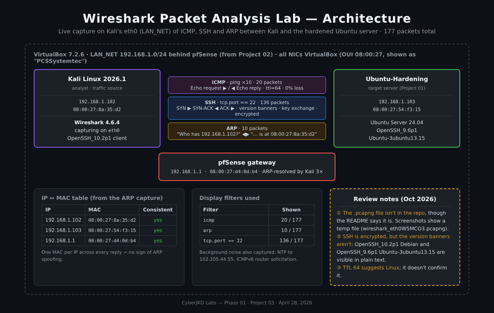
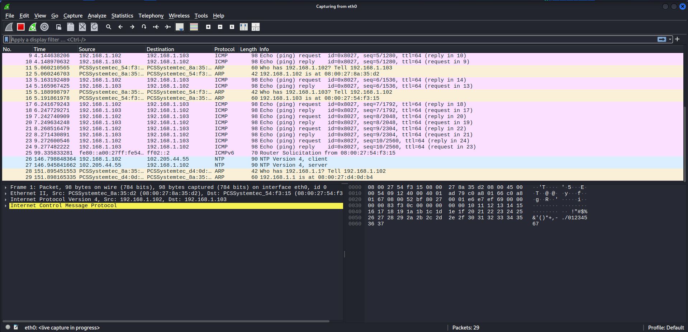
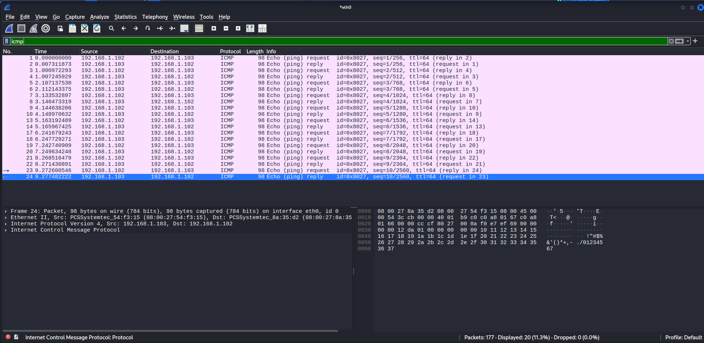
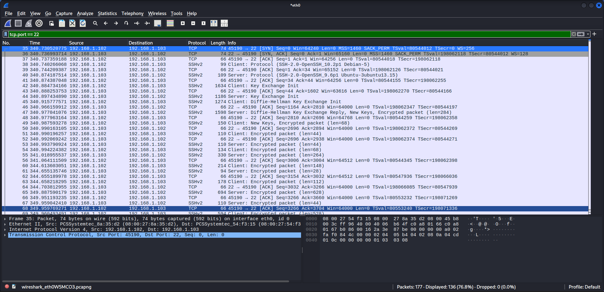
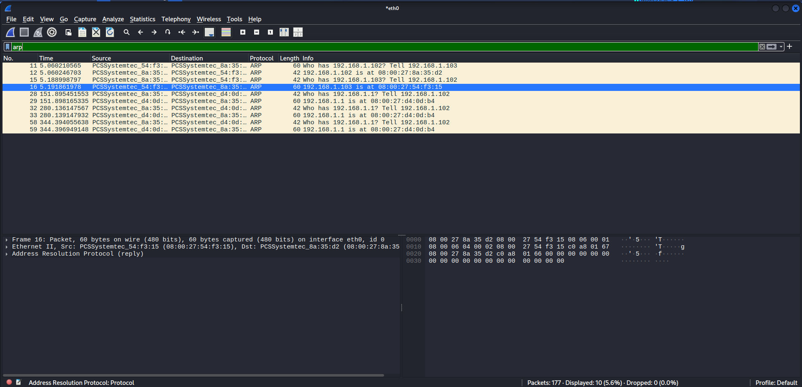

# Wireshark Packet Analysis Lab - ICMP, SSH and ARP on a Live LAN


| | |
|---|---|
| **Author** | Dalla Samuel (CyberJKD) |
| **Date** | April 28, 2026 |
| **Platform** | VirtualBox 7.2.6 · Windows 11 · AMD Ryzen 3 PRO 5450U · 32 GB RAM |
| **Roadmap** | Phase 01 · Project 03 |
| **Network** | LAN_NET from [Project 02](../project-02-network-segmentation) · target server from [Project 01](../project-01-linux-hardening) |

---

## Objective

Capture and analyse live network traffic between Kali Linux and Ubuntu-Hardening using Wireshark. Identify protocols, understand packet structure, and document the findings as evidence of network analysis skills.

## Business Problem

When something breaks or looks suspicious on a network, logs only tell part of the story. The packets show what actually happened: who talked to whom, with which protocol, and whether anything was exposed. Support engineers use packet captures to troubleshoot connectivity, and SOC analysts use them to confirm or rule out attacks. This lab builds that skill on three protocols every network relies on.

## Environment

| VM | IP Address | MAC Address | Role |
|---|---|---|---|
| Kali Linux 2026.1 | 192.168.1.102 | 08:00:27:8a:35:d2 | Analyst · runs Wireshark |
| Ubuntu-Hardening (Ubuntu Server 24.04) | 192.168.1.103 | 08:00:27:54:f3:15 | Target server |
| pfSense | 192.168.1.1 | 08:00:27:d4:0d:b4 | Gateway / firewall |

**Tools:** Wireshark 4.6.4 (on Kali, capturing on `eth0`), OpenSSH (client 10.2p1 on Kali, server 9.6p1 on Ubuntu), `ping` (ICMP)

All three MAC addresses start with `08:00:27`, VirtualBox's vendor prefix, which Wireshark labels **PCSSystemtec**.

## Key Concepts

- **Packet capture**: recording every frame that crosses a network interface, then filtering it afterwards.
- **Display filters**: Wireshark expressions like `icmp`, `arp` or `tcp.port == 22` that hide everything except the traffic you're investigating.
- **ICMP**: the protocol behind `ping`; an Echo request gets an Echo reply. **TTL** (time to live) starts at a value set by the operating system and drops by 1 at every router.
- **TCP three-way handshake**: SYN → SYN-ACK → ACK opens every TCP connection, including SSH.
- **SSH key exchange**: both sides agree on encryption keys first; after the "New Keys" message, everything is encrypted.
- **ARP**: Layer 2 address resolution. "Who has this IP?" is broadcast, and the owner replies with its MAC address. ARP has no authentication, which is why ARP spoofing works.

## Architecture



```
VirtualBox 7.2.6 · LAN_NET (192.168.1.0/24, behind pfSense from Project 02)
   │
   ├── Kali Linux 2026.1 · 192.168.1.102 · Wireshark 4.6.4 capturing on eth0
   │        │
   │        ├── ICMP  ping ×10 ─────────────▶ Ubuntu-Hardening   (20 packets)
   │        ├── SSH   tcp/22 handshake + KEX ─▶ Ubuntu-Hardening  (136 packets)
   │        └── ARP   who-has / is-at ◀──────▶ Ubuntu + pfSense   (10 packets)
   │
   ├── Ubuntu-Hardening · 192.168.1.103 · OpenSSH_9.6p1
   └── pfSense gateway  · 192.168.1.1

Total in capture: 177 packets (includes background NTP and ICMPv6)
```

---

## Traffic Captured

### 1. ICMP Traffic (Ping)

Generated 10 pings from Kali to Ubuntu-Hardening.

**What was observed:**

- 10 Echo requests from 192.168.1.102 → 192.168.1.103
- 10 Echo replies from 192.168.1.103 → 192.168.1.102
- 0% packet loss: every request has a matching reply (`id=0x8027`, `seq=1` to `10`)
- TTL 64 on all packets



*Unfiltered live capture: ICMP pings mixed with ARP lookups, an ICMPv6 router solicitation and NTP time-sync traffic to 102.205.44.55. This is real background noise on any network.*



*Display filter `icmp`: 20 of 177 packets (10 request/reply pairs), all TTL 64.*

### 2. SSH Traffic (Port 22)

Started an SSH session from Kali into Ubuntu-Hardening.

**What was observed:**

- TCP three-way handshake: `45190 → 22 [SYN]`, `22 → 45190 [SYN, ACK]`, `45190 → 22 [ACK]` (packets 35-37)
- SSH version exchange in **plain text**: client `SSH-2.0-OpenSSH_10.2p1 Debian-5`, server `SSH-2.0-OpenSSH_9.6p1 Ubuntu-3ubuntu13.15`
- Key Exchange Init from both sides, then Diffie-Hellman Key Exchange Init / Reply and **New Keys**
- Everything after New Keys is shown only as `Encrypted packet`
- No usernames, passwords or commands visible: encryption working correctly



*Display filter `tcp.port == 22`: 136 of 177 packets. Handshake, version banners, key exchange, then encrypted traffic only.*

### 3. ARP Traffic

ARP packets captured during communication between the machines.

**What was observed:**

- "Who has 192.168.1.102? Tell 192.168.1.103": Ubuntu resolving Kali's MAC
- "192.168.1.102 is at 08:00:27:8a:35:d2": Kali responding
- "Who has 192.168.1.103? Tell 192.168.1.102" → "192.168.1.103 is at 08:00:27:54:f3:15"
- "Who has 192.168.1.1? Tell 192.168.1.102" (3 times) → always "is at 08:00:27:d4:0d:b4": Kali refreshing the pfSense gateway entry



*Display filter `arp`: 10 of 177 packets. Every IP always answered with the same MAC.*

## Command Reference

```bash
# Generate traffic (from Kali)
ping -c 10 192.168.1.103
ssh dalla@192.168.1.103

# Capture from the command line instead of the GUI
sudo tshark -i eth0 -w cyberjkd-packet-capture.pcapng

# Wireshark display filters used
icmp
arp
tcp.port == 22

# Useful extra filters
ssh.protocol                         # just the SSH version banners
tcp.flags.syn == 1 && tcp.flags.ack == 0   # new TCP connections (SYN only)
arp.duplicate-address-detected       # possible ARP spoofing
```

## Key Findings

| Protocol | Packets | Purpose | Security notes |
|---|---|---|---|
| ICMP | 20 | Connectivity testing | Reveals live hosts. Restrict or monitor it in production. |
| SSH | 136 | Remote access | Session fully encrypted, but **version banners are plain text** (see Review Note 2) |
| ARP | 10 | IP → MAC resolution | One MAC per IP across all replies, so no spoofing detected |

## Verification Checklist

- [x] Live capture on `eth0` (177 packets, 0 dropped)
- [x] 10 ICMP request/reply pairs, 0% loss, TTL 64
- [x] Complete TCP handshake to port 22 captured
- [x] SSH key exchange captured; all session data encrypted
- [x] No credentials visible in the SSH traffic
- [x] ARP requests and replies for Kali, Ubuntu and pfSense; IP-to-MAC mapping consistent
- [x] Display filters `icmp`, `arp`, `tcp.port == 22` used to isolate traffic
- [ ] Capture file (`.pcapng`) published with the lab: **not in the repo, see Review Note 1**

## What This Demonstrates

- ICMP reveals live hosts on a network: useful for recon, and a reason to restrict ping in production.
- SSH traffic is encrypted end to end. Wireshark shows the handshake but not credentials or commands.
- ARP works at Layer 2, resolving IPs to MACs before any IP communication can start.
- Wireshark display filters (`icmp`, `tcp.port == 22`, `arp`) isolate specific traffic quickly.

## Review Notes (October 2026)

I came back to this lab after later projects and reviewed it the way I'd review someone else's work. The analysis holds up. These notes correct and extend it.

**1. The capture file isn't in the repo.** The original README said `cyberjkd-packet-capture.pcapng` was "available in this directory", but only the screenshots were uploaded. The SSH screenshot shows Wireshark's temporary file name (`wireshark_eth0W5MCO3.pcapng`), which suggests the capture may never have been saved under that name. Next time: **File → Save As** (or `tshark -w`) before closing Wireshark, and upload the `.pcapng` so anyone can open it and check my analysis.

**2. SSH encrypts the session, not the version banner.** Before encryption starts, both sides announce their software in plain text: `OpenSSH_10.2p1 Debian-5` (Kali) and `OpenSSH_9.6p1 Ubuntu-3ubuntu13.15` (server). That tells anyone watching the network, or scanning port 22, exactly which OpenSSH build and Ubuntu package the server runs, which is useful for matching it against known vulnerabilities. It can't be hidden completely (the protocol needs it), but it's a good reason to keep OpenSSH patched and to watch for scans of port 22.

**3. "Diffie-Hellman" is Wireshark's generic label.** Wireshark names the key-exchange messages "Diffie-Hellman Key Exchange Init/Reply" whatever algorithm is used. The actual algorithm the two sides agreed on is listed inside the **Key Exchange Init** packets (`kex_algorithms`). Expanding those is the way to report it precisely.

**4. TTL 64 *suggests* Linux; it doesn't confirm it.** Linux and macOS start packets at TTL 64 and Windows at 128, and each router hop subtracts 1. Here both machines are on the same subnet, so 64 arrives unchanged, which fits Linux. But TTL can be changed, so it's a strong hint for OS fingerprinting, not proof.

## Lessons Learned

- Always capture on the correct interface: `eth0` for LAN traffic.
- Filter after capture, not before: capture everything, then analyse selectively. *(On busy production links, a capture filter is still needed to keep file sizes manageable.)*
- SSH encryption means Wireshark can't read the session content, and that is the correct behaviour.
- ARP packets reveal MAC addresses, which is useful for network mapping.
- ICMP TTL 64 suggests a Linux target (Windows uses 128).
- *(Added on review)* Save the `.pcapng` and publish it with the write-up. It's the raw evidence.

## Connection to Roadmap

**Phase 01 · Project 03** of the [CyberJKD Roadmap](https://dallasamuel.github.io/CyberJKD-Roadmap). It reuses the network from [Project 02](../project-02-network-segmentation) and the server from [Project 01](../project-01-linux-hardening). The same skill is repeated in the cloud in [Phase 03 · Wireshark & Network Analysis (Azure VM)](../../phase-03/project-03-wireshark-network-analysis), where 24,830 packets were captured on an Azure VM.

## References

- [CyberJKD Roadmap](https://dallasamuel.github.io/CyberJKD-Roadmap/)
- [Wireshark Documentation](https://www.wireshark.org/docs/)
- [Wireshark Display Filters](https://wiki.wireshark.org/DisplayFilters)
- [RFC 4253: SSH Transport Layer Protocol](https://datatracker.ietf.org/doc/html/rfc4253)

---

🌐 Full roadmap: [dallasamuel.github.io/CyberJKD-Roadmap](https://dallasamuel.github.io/CyberJKD-Roadmap)

🔗 All labs: [github.com/DallaSamuel/CyberJKD-Labs](https://github.com/DallaSamuel/CyberJKD-Labs)

---

*CyberJKD - Becoming dangerous through fundamentals. 🔒*
