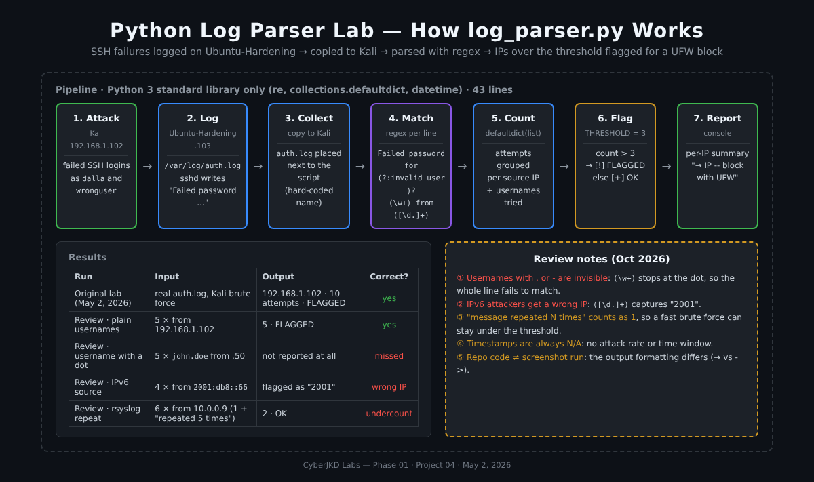
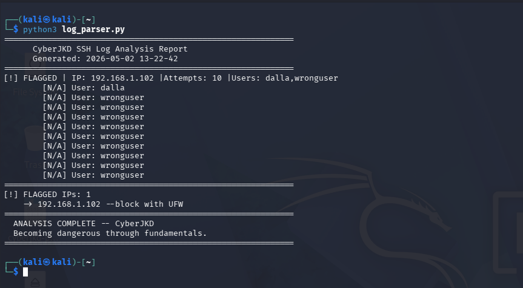
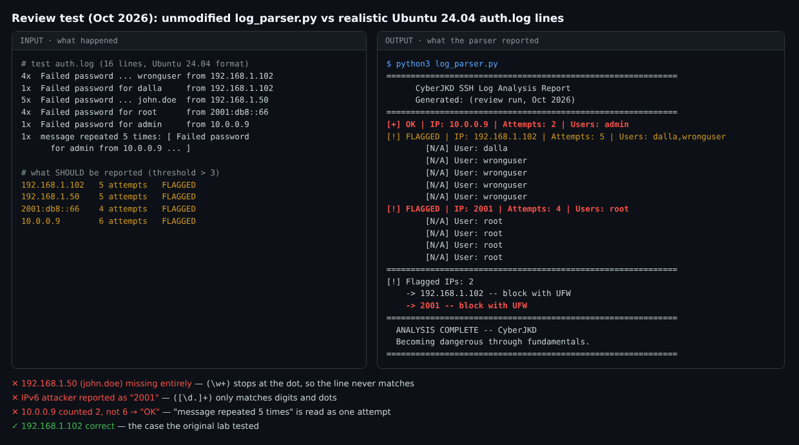

# Python Log Parser Lab - Detecting SSH Brute Force in auth.log


| | |
|---|---|
| **Author** | Dalla Samuel (CyberJKD) |
| **Date** | May 2, 2026 |
| **Platform** | VirtualBox 7.2.6 · Windows 11 · AMD Ryzen 3 PRO 5450U · 32 GB RAM |
| **Roadmap** | Phase 01 · Project 04 |
| **Code** | [`log_parser.py`](log_parser.py) (Python 3, standard library only, 43 lines) |

---

## Objective

Build a Python script that parses an Ubuntu Server `auth.log`, detects failed SSH login attempts, flags source IPs that go over a threshold, and prints a clean analysis report.

## Business Problem

Every internet-facing Linux server gets hit by automated SSH password guessing. The evidence sits in `/var/log/auth.log`, but nobody can read thousands of lines by hand. A SOC needs that log turned into an answer: **which IPs are attacking, how many times, and with which usernames**, so the attacker can be blocked. This script is that first step, and the same logic a SIEM alert rule uses.

## Environment

| VM | IP Address | Role |
|---|---|---|
| Kali Linux 2026.1 | 192.168.1.102 | Attacker (failed SSH logins) · runs the parser |
| Ubuntu-Hardening | 192.168.1.103 | Target server · source of `auth.log` |
| pfSense | 192.168.1.1 | Gateway / firewall |

**Tools:** Python 3 (`re`, `collections.defaultdict`, `datetime`), `auth.log` from Ubuntu-Hardening, OpenSSH

## Key Concepts

- **auth.log**: Ubuntu's authentication log. `sshd` writes a `Failed password for <user> from <ip>` line for every wrong password.
- **Regular expressions**: patterns that find and extract parts of text. Here: the username and the source IP.
- **Aggregation**: grouping events by a key (source IP) and counting them, using `defaultdict(list)`.
- **Threshold detection**: more than N failures from one IP = suspicious. It's the simplest form of a SIEM correlation rule.
- **Detection gaps**: a parser only sees what its pattern matches. Anything the regex misses is invisible to the analyst.

## Architecture



```
Kali (192.168.1.102) ── failed SSH logins ──▶ Ubuntu-Hardening (192.168.1.103)
                                                   │
                                                   ▼
                                       /var/log/auth.log  (sshd: "Failed password …")
                                                   │  copied to Kali
                                                   ▼
log_parser.py
   ├── read auth.log line by line
   ├── regex: Failed password for (?:invalid user )?(\w+) from ([\d.]+)
   ├── group by source IP → list of usernames   (defaultdict)
   ├── count > THRESHOLD (3) → [!] FLAGGED, else [+] OK
   └── report: per-IP summary + "→ <ip> -- block with UFW"
```

---

## What the Script Does

- Reads `auth.log` and searches for failed SSH login attempts
- Extracts the username and IP address from each failed attempt
- Counts attempts per IP address
- Flags any IP with more than 3 failed attempts
- Prints a clean report with a recommended UFW block action

## Usage

```bash
# On Ubuntu-Hardening: copy the log somewhere readable
sudo cp /var/log/auth.log ~/auth.log && sudo chown $USER ~/auth.log

# Next to log_parser.py (the script reads a file named auth.log in the current folder)
python3 log_parser.py

# Act on the result
sudo ufw deny from 192.168.1.102
```

## Results

| IP Address | Attempts | Users Tried | Status |
|---|---|---|---|
| 192.168.1.102 | 10 | wronguser, dalla | FLAGGED |



*Original run on Kali (May 2, 2026): 192.168.1.102 flagged with 10 failed attempts, 1 as the real user `dalla` and 9 as the invalid user `wronguser`. Recommended action: block with UFW.*

## Key Findings

- 192.168.1.102 (Kali) was flagged with 10 failed attempts
- Both the valid user `dalla` and the invalid user `wronguser` were attempted
- The script correctly identified and flagged the brute-force pattern
- Recommended action: block 192.168.1.102 with UFW (done in [Project 05](../project-05-brute-force-simulation))

## Verification Checklist

- [x] Parses a real `auth.log` from Ubuntu-Hardening
- [x] Matches both valid-user and `invalid user` failures
- [x] Groups attempts per IP and lists the usernames tried
- [x] Flags 192.168.1.102 (10 attempts > threshold 3)
- [x] Recommends a UFW block for each flagged IP
- [ ] Detects usernames containing `.` or `-`: **fails, see Review Note 1**
- [ ] Reports IPv6 sources correctly: **fails, see Review Note 2**
- [ ] Counts `message repeated N times` lines correctly: **fails, see Review Note 3**

## Review Notes (October 2026)

I came back to this script after later projects and tested it the way I'd test someone else's detection tool: against log lines it wasn't written for. **The code is unchanged.** The original case still works, but the test found three ways an attacker could slip past it.



**1. Usernames with a dot or dash are invisible.** The regex captures the username with `(\w+)`, which only matches letters, digits and underscores. For `Failed password for invalid user john.doe from 192.168.1.50`, the match stops at `john`, the next expected text (` from`) isn't there, and **the whole line is skipped**. In the test, 5 attempts against `john.doe` produced no output at all. Real attackers try usernames like `ubuntu-admin` and `first.last` all the time.
*Fix:* `(\S+)` (any non-space characters) for the username.

**2. IPv6 attackers get the wrong IP.** `([\d.]+)` only matches digits and dots, so `2001:db8::66` becomes **`2001`**. The script then recommends "block 2001 with UFW", which blocks nothing.
*Fix:* `([0-9a-fA-F:.]+)` for the address, or anchor on ` port ` and capture everything before it.

**3. Repeated messages are counted once.** When the same line repeats, rsyslog can collapse it into `message repeated 5 times: [ Failed password for admin from 10.0.0.9 … ]`. The script counts that as **one** attempt, so 6 real attempts showed as 2, and the IP was marked **OK** instead of FLAGGED.
*Fix:* detect `message repeated (\d+) times` and add that number.

> The fixes for Notes 1-3 were checked against the same test log: with them, all four sources are counted correctly (192.168.1.102: 5, 192.168.1.50: 5, 2001:db8::66: 4, 10.0.0.9: 6).

**4. Timestamps are always `N/A`.** The script stores `'ts': 'N/A'` instead of parsing the time, so it can't tell 10 attempts in 10 seconds (an attack) from 10 typos over a month. Ubuntu 24.04 writes ISO timestamps (`2026-05-02T13:20:01…`) at the start of every line, which are easy to parse.

**5. The repo code isn't exactly the version in the screenshot.** The screenshot prints `→ 192.168.1.102 --block with UFW` and `|Attempts:` without spaces, while `log_parser.py` prints `->` and `-- block` with spaces. The logic is the same, but the code that produced the evidence should be the code that's published.

## What I'd Change for Production

- **Fix the patterns**: `(\S+)` for usernames, IPv4 + IPv6 for addresses (Review Notes 1, 2).
- **Count repeats** from `message repeated N times` (Review Note 3).
- **Time windows**: parse timestamps and flag *N failures in M minutes*, which is how real brute-force rules work (Review Note 4).
- **Catch more failure types**: `Invalid user … from`, `maximum authentication attempts exceeded`, `Connection closed by authenticating user`.
- **CLI arguments** instead of a hard-coded `auth.log` and threshold, e.g. `python3 log_parser.py /var/log/auth.log --threshold 5`.
- **Unit tests** with sample log lines (including the 3 failing cases above), so a regex change can't silently break detection.
- **Use the platform**: in production this becomes a SIEM rule. See the [Splunk SIEM lab](../../phase-02/project-01-splunk-siem-lab), where SPL counts SSH failures per IP and raises an alert.

## What This Demonstrates

- Python scripting for security automation
- Log parsing and pattern matching with regex
- Automated threat detection logic
- The same analysis SOC analysts perform on SSH logs every day
- *(On review)* Testing a detection against edge cases, not just the case it was built for

## Lessons Learned

- `auth.log` format varies by Linux distro and version.
- Regex patterns must match the exact log format.
- Threshold-based flagging is the foundation of SIEM alerting.
- Automating log analysis removes human error from detection.
- *(Added on review)* A detection that silently skips lines is worse than one that errors: you don't know what you're missing. Test with the inputs an attacker would choose.

## Connection to Roadmap

**Phase 01 · Project 04** of the [CyberJKD Roadmap](https://dallasamuel.github.io/CyberJKD-Roadmap). The parser is reused in [Project 05 (Brute Force Simulation + Log Analysis)](../project-05-brute-force-simulation) to detect a Hydra attack, and the same idea, done properly at scale, is the [Splunk SIEM lab](../../phase-02/project-01-splunk-siem-lab) in Phase 02.

## References

- [CyberJKD Roadmap](https://dallasamuel.github.io/CyberJKD-Roadmap/)
- [Python `re` module](https://docs.python.org/3/library/re.html)
- [Ubuntu: Linux log files](https://help.ubuntu.com/community/LinuxLogFiles)

---

🌐 Full roadmap: [dallasamuel.github.io/CyberJKD-Roadmap](https://dallasamuel.github.io/CyberJKD-Roadmap)

🔗 All labs: [github.com/DallaSamuel/CyberJKD-Labs](https://github.com/DallaSamuel/CyberJKD-Labs)

---

*CyberJKD - Becoming dangerous through fundamentals. 🔒*
