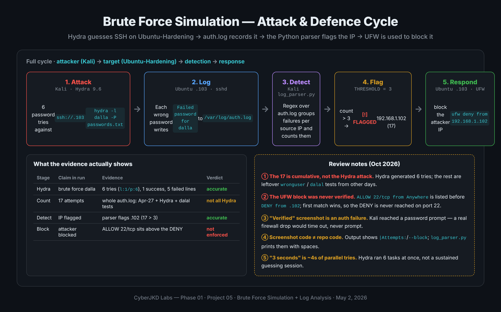
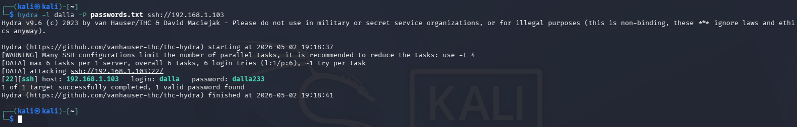
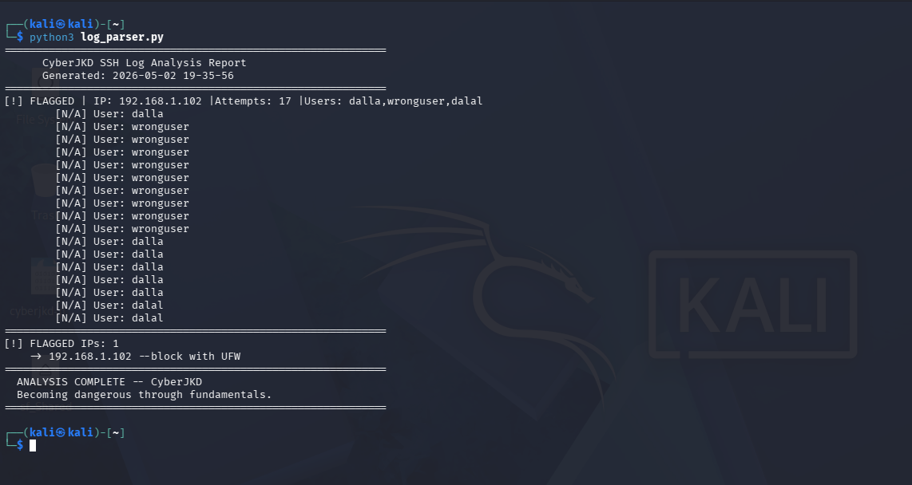
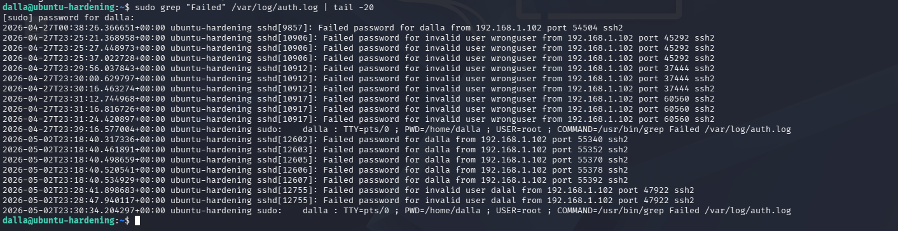
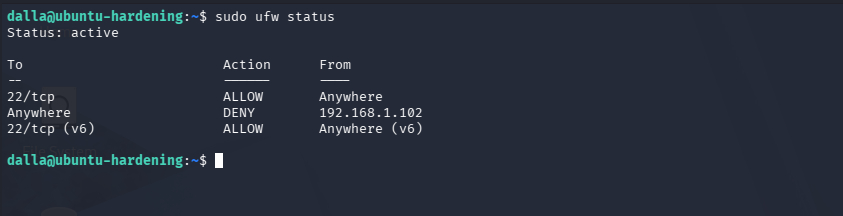
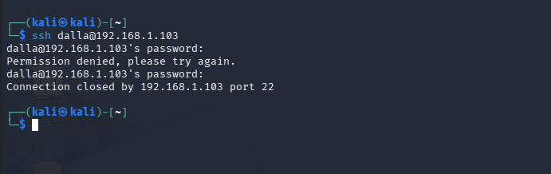

# Brute Force Simulation + Log Analysis Lab - SSH Attack & Defence Cycle


| | |
|---|---|
| **Author** | Dalla Samuel (CyberJKD) |
| **Date** | May 2, 2026 |
| **Platform** | VirtualBox 7.2.6 · Windows 11 · AMD Ryzen 3 PRO 5450U · 32 GB RAM |
| **Roadmap** | Phase 01 · Project 05 |
| **Detection** | [`log_parser.py`](../project-04-python-log-parser/log_parser.py) (reused from Project 04) |

---

## Objective

Simulate a real SSH brute force attack from Kali Linux against Ubuntu-Hardening using Hydra, capture the attack in `auth.log`, detect it using the Python log parser, and block the attacker using UFW. Full attack and defence cycle documented.

## Business Problem

Weak SSH passwords are the single most exploited door into a Linux server. An attacker doesn't need a zero-day; a wordlist and a brute-force tool are enough. A SOC has to show the whole loop works end to end: the attack lands in a log, the log turns into a detection, and the detection turns into a block that actually stops the attacker. Doing each half in isolation proves nothing. This lab runs the complete cycle on purpose, so the handoffs between **attack → log → detection → response** can be inspected and the weak link found.

## Environment

| VM | IP Address | Role |
|---|---|---|
| Kali Linux | 192.168.1.102 | Attacker (runs Hydra + the parser) |
| Ubuntu-Hardening | 192.168.1.103 | Target server (SSH + `auth.log` + UFW) |
| pfSense | 192.168.1.1 | Gateway / firewall |

**Tools:** Hydra 9.6 (Kali), OpenSSH (target service), [`log_parser.py`](../project-04-python-log-parser/log_parser.py) from Project 04 (detection), UFW (blocking)

## Key Concepts

- **Brute force**: trying passwords one after another from a wordlist until one works. Hydra automates this against a live service.
- **Parallel tasks**: Hydra opens several SSH connections at once (`-t`), so "6 tries" can finish in seconds, and each connection carries only a few attempts.
- **auth.log as evidence**: every wrong password writes a `Failed password for <user> from <ip>` line. The log is the ground truth the detection reads.
- **Threshold detection**: the parser flags any source IP over 3 failures. It's the same logic a SIEM correlation rule uses.
- **Firewall rule order**: UFW evaluates rules top to bottom and stops at the first match. A block rule only works if it sits *above* any broader allow rule for the same traffic.
- **Full IR cycle**: attack → logging → detection → response is the loop a SOC runs for real. A lab is where you confirm every handoff holds.

## Architecture



```
Kali (192.168.1.102)                         Ubuntu-Hardening (192.168.1.103)
  │                                                     │
  │  1. hydra -l dalla -P passwords.txt ssh://.103      │
  ├──────────── 6 password tries over SSH ─────────────▶ sshd
  │                                                     │
  │                                      2. each wrong password →
  │                                         /var/log/auth.log
  │                                         "Failed password for dalla …"
  │                                                     │
  │◀──────────── copy auth.log to Kali ─────────────────┤
  │                                                     │
  ▼                                                     │
3. log_parser.py  (THRESHOLD = 3)                       │
   regex → group failures per source IP → count        │
   192.168.1.102 over threshold → [!] FLAGGED           │
   │                                                    │
   │  4. act on the flagged IP                          │
   └──────── sudo ufw deny from 192.168.1.102 ─────────▶ UFW
                                                        (see Review Note 2: rule order)
```

---

## Attack Phase

Generated a password wordlist on Kali:

```
wrongpass, 123456, password, dalla233, kali, root123
```

Ran Hydra against Ubuntu-Hardening SSH:

```bash
hydra -l dalla -P passwords.txt ssh://192.168.1.103
```

**Result:**

```
[22][ssh] host: 192.168.1.103  login: dalla  password: dalla233
1 of 1 target successfully completed, 1 valid password found
```



## Detection Phase

Copied fresh `auth.log` from Ubuntu-Hardening to Kali and ran the log parser:

```bash
python3 log_parser.py
```

**Result:**

```
[!] FLAGGED | IP: 192.168.1.102 | Attempts: 17 | Users: dalla, wronguser, dalal
[!] Flagged IPs: 1
-> 192.168.1.102 -- block with UFW
ANALYSIS COMPLETE -- CyberJKD
```



## Log Evidence

`auth.log` confirmed multiple failed attempts from 192.168.1.102 during the Hydra attack at 2026-05-02 19:18 (local). The log also carried older failed-login tests from earlier dates, which the parser counted together (see Review Note 1).



## Response Phase

Blocked the attacker IP using UFW on Ubuntu-Hardening:

```bash
sudo ufw deny from 192.168.1.102 to any
```



Verified block - Kali SSH attempt refused:

```
Permission denied, please try again.
Connection closed by 192.168.1.103 port 22
```



## Key Findings

| Stage | Tool | Result |
|---|---|---|
| Attack | Hydra 9.6 | Password cracked in ~4 seconds (6 parallel tries) |
| Logging | auth.log | 5 failed Hydra attempts recorded (17 in log overall) |
| Detection | Python log parser | IP flagged automatically |
| Response | UFW | Block rule added (not enforced - see Review Note 2) |

## Command Reference

| Command | Where | Purpose |
|---|---|---|
| `hydra -l dalla -P passwords.txt ssh://192.168.1.103` | Kali | Brute force one user against the target's SSH |
| `hydra -l dalla -P passwords.txt -t 4 ssh://192.168.1.103` | Kali | Same, but 4 parallel tasks (Hydra's own recommendation for SSH) |
| `sudo grep "Failed" /var/log/auth.log \| tail -20` | Ubuntu | Read the most recent failed logins |
| `sudo cp /var/log/auth.log ~/auth.log && sudo chown $USER ~/auth.log` | Ubuntu | Make the log readable to copy to Kali |
| `scp dalla@192.168.1.103:~/auth.log .` | Kali | Pull the log next to the parser |
| `python3 log_parser.py` | Kali | Run detection over `auth.log` in the current folder |
| `sudo ufw status numbered` | Ubuntu | Show rules **with their order** (needed to place a block correctly) |
| `sudo ufw deny from 192.168.1.102 to any` | Ubuntu | Append a block for the attacker IP |
| `sudo ufw insert 1 deny from 192.168.1.102 to any` | Ubuntu | Put the block **first** so it beats the allow rule (see Review Note 2) |

## Verification Checklist

- [x] Hydra cracks `dalla233` from the wordlist against live SSH
- [x] Successful login does **not** appear as a `Failed password` line (6 tries → 5 failures logged)
- [x] `auth.log` records the failed attempts from 192.168.1.102
- [x] The parser flags 192.168.1.102 (17 attempts > threshold 3)
- [x] A UFW `deny` rule for the attacker IP is added
- [ ] The 17 attempts all came from this Hydra run: **no, see Review Note 1**
- [ ] The UFW block actually stops the attacker on port 22: **no, see Review Note 2**
- [ ] The "verified block" screenshot proves a firewall drop: **no, see Review Note 3**

## Review Notes (October 2026)

I came back to this lab after later projects and re-checked every claim against the screenshots and against the real parser. **No original content was changed.** The attack and the detection hold up. Two of the summary claims overstate what the evidence shows, and the block was never actually enforced.

**1. The "17 attempts" is the whole log, not the Hydra attack.** Hydra ran `-l dalla -P passwords.txt` with `6 login tries (l:1/p:6)` and finished with 1 success, so it generated **6 tries = 5 failed + 1 successful**. The parser's `Attempts: 17` counts the *entire* `auth.log`: the `auth-log-brute-force.png` evidence shows failed logins dated **April 27** (a batch of `invalid user wronguser`) and **May 2** (the Hydra `dalla` run, plus `invalid user dalal` tests). Rebuilding that log from the screenshot and running the published `log_parser.py` reproduces `Attempts: 17 | Users: dalla, wronguser, dalal` exactly - 10 `wronguser`, 5 Hydra `dalla` + 1 earlier `dalla`, 2 `dalal`. So "auth.log recorded 17 attempts" is true; "the Hydra attack generated 17 attempts" is not. The detection still correctly flags the IP either way.
*Takeaway:* clear the log (or note the window) before a run so the evidence maps 1:1 to the attack.

**2. The UFW block was never enforced - the rule order defeats it.** `ufw-block-attacker.png` shows:

```
To              Action   From
--              ------   ----
22/tcp          ALLOW    Anywhere          <-- matches the attacker's SSH first
Anywhere        DENY     192.168.1.102     <-- never reached for port 22
22/tcp (v6)     ALLOW    Anywhere (v6)
```

UFW checks rules top to bottom and the **first match wins**. The `ALLOW 22/tcp from Anywhere` rule sits above the `DENY from 192.168.1.102`, so the attacker's SSH traffic matches the allow rule and the deny is never evaluated. The deny only covers ports *other than* 22 - i.e. nothing the attacker was using.
*Fix:* delete the appended rule and insert the block first so it takes precedence:
```bash
sudo ufw status numbered
sudo ufw delete <number of the DENY rule>
sudo ufw insert 1 deny from 192.168.1.102 to any
sudo ufw status
```

**3. The "verified block" screenshot is an auth failure, not a firewall drop.** In `ufw-block-verified.png`, Kali runs `ssh dalla@192.168.1.103` and **reaches a password prompt**, types a password, gets `Permission denied, please try again`, and then `Connection closed by 192.168.1.103 port 22`. That is normal `sshd` behaviour after a wrong password hits `MaxAuthTries` - the connection got all the way to the SSH service. A firewall that was actually dropping 192.168.1.102 would make the client **hang and time out** (or get an immediate reject); Kali would never see a login prompt. So this screenshot confirms the service is still reachable, which is consistent with Note 2, not a successful block.
*How to verify a real block:* from Kali, `ssh -v dalla@192.168.1.103` should stall at `Connecting to 192.168.1.103 … ` and time out, and on the target `sudo tail -f /var/log/ufw.log` should show `[UFW BLOCK]` lines for 192.168.1.102.

**4. Screenshot output doesn't match the published parser code.** The detection screenshot prints `|Attempts:` and `--block` with no spaces, while the committed [`log_parser.py`](../project-04-python-log-parser/log_parser.py) prints `| Attempts:` and `-- block` with spaces. Same mismatch noted in Project 04 (Review Note 5): the evidence was produced by a slightly different, unpublished version of the script. The logic and the counts are identical; only the spacing differs.

**5. "Cracked in 3 seconds" is ~4 seconds of parallel guessing.** Hydra's own timestamps read `starting at 19:18:37` and `finished at 19:18:41` - about 4 seconds - and it used `max 6 tasks` running in parallel. The point stands (weak passwords fall almost instantly), but it was 6 concurrent attempts, not a sustained sequential session, and the wordlist only had 6 entries with the real password inside it.

## What I'd Change for Production

- **Fix the firewall rule order** so the block is actually enforced (Review Notes 2, 3): `ufw insert 1 deny …`, and verify with a timed-out connection + `ufw.log`, not a password prompt.
- **Rate-limit SSH** instead of (or before) blocking by IP: `sudo ufw limit 22/tcp` throttles repeat connections from any source, which catches attackers whose IP you haven't seen yet.
- **Key-only auth**: set `PasswordAuthentication no` in `sshd_config`. Hydra's whole attack depends on password auth being on.
- **Isolate the evidence per run**: rotate or note the `auth.log` window so a detection's count maps to one attack (Review Note 1).
- **Detect by time window, not just total count**: 17 failures over a month is noise; 5 in 4 seconds is an attack. This is Project 04's Review Note 4, and it's what a real rule keys on.
- **Automate the response**: tools like `fail2ban` watch `auth.log` and insert a correctly-ordered block automatically, closing the gap between detection and response that this lab had to bridge by hand.
- **Publish the exact code that made the evidence** (Review Note 4).

## What This Demonstrates

- Real brute force attacks can crack weak passwords in seconds
- Linux `auth.log` captures every failed attempt automatically
- Automated log parsing detects attacks faster than manual review
- UFW can block attackers at the firewall level - *if the rule is ordered correctly*
- This is the full SOC incident response cycle in a lab environment
- *(On review)* Verifying a control end to end, not just adding it - a block that was added but never enforced is the exact failure this review caught

## Lessons Learned

- Hydra cracked `dalla233` because it was in the wordlist
- `MaxAuthTries 3` limited attempts per connection, but Hydra rotated connections (visible as different source ports and `sshd` PIDs in the log) to keep going
- Automated detection is essential - manual log review is too slow
- Block by IP immediately after detection - don't wait
- Strong unique passwords not in common wordlists defeat Hydra
- *(Added on review)* Adding a firewall rule is not the same as enforcing it. Check **order** with `ufw status numbered`, and prove a block by making the attacker time out - not by watching a password get rejected, which means the service was reachable all along.
- *(Added on review)* A detection's count is only as clean as the log behind it. Clear or scope `auth.log` so the numbers you report belong to the attack you ran.

## Connection to Roadmap

**Phase 01 · Project 05** of the [CyberJKD Roadmap](https://dallasamuel.github.io/CyberJKD-Roadmap). This lab is the live-fire companion to [Project 04 (Python Log Parser)](../project-04-python-log-parser): Project 04 built and tested the detection; here it runs against a real Hydra attack and drives a firewall response. The same detection idea, done properly at scale with time windows and alerting, becomes the [Splunk SIEM lab](../../phase-02/project-01-splunk-siem-lab) in Phase 02.

## References

- [CyberJKD Roadmap](https://dallasamuel.github.io/CyberJKD-Roadmap/)
- [Hydra Documentation (thc-hydra)](https://github.com/vanhauser-thc/thc-hydra)
- [UFW Documentation](https://help.ubuntu.com/community/UFW)
- [UFW rule order and precedence](https://www.baeldung.com/linux/ufw-rules-order)

---

🌐 Full roadmap: [dallasamuel.github.io/CyberJKD-Roadmap](https://dallasamuel.github.io/CyberJKD-Roadmap)

🔗 All labs: [github.com/DallaSamuel/CyberJKD-Labs](https://github.com/DallaSamuel/CyberJKD-Labs)

---

*CyberJKD - Becoming dangerous through fundamentals. 🔒*
