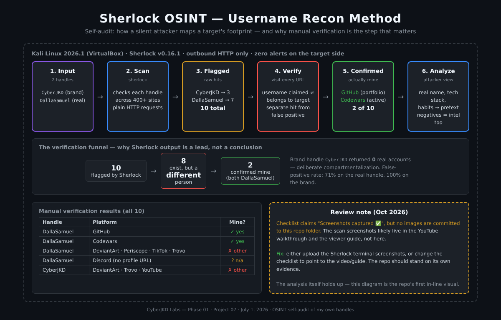

# Sherlock OSINT - Username Intelligence Recon


| | |
|---|---|
| **Author** | Dalla Samuel (CyberJKD) |
| **Date** | July 1, 2026 |
| **Platform** | Kali Linux 2026.1 · Oracle VirtualBox |
| **Lab Source** | NetworkChuck - "Use a python hacking tool (Sherlock) to find social media accounts" |
| **Roadmap** | [Phase 01 · Project 07 - Systems Foundation](https://dallasamuel.github.io/CyberJKD-Roadmap) |

---

## Objective

Conduct a username-based OSINT **self-audit** using Sherlock to enumerate my own platform presence across 400+ sites, manually verify all flagged results to separate true hits from false positives, and analyze the findings through the lens of real attacker methodology - demonstrating practical threat modeling and personal OPSEC awareness.

This audit targets only my own handles. The point is to see my own footprint before an attacker does.

---

## Business Problem This Lab Solves

Organizations and individuals routinely underestimate their digital footprint. A threat actor performing pre-attack reconnaissance uses tools like Sherlock to rapidly map a target's platform presence - uncovering email patterns, behavioral data, location clues, and social engineering vectors without triggering a single alert.

This lab demonstrates what that recon looks like from the attacker's perspective, and what the defender should do about it.

| Role | How this applies |
|---|---|
| Cloud Security Engineer | Assess and minimize organizational OSINT exposure surface |
| SOC Analyst | Understand attacker recon methodology before alert triage |
| Penetration Tester | Username enumeration as a standard pre-engagement recon step |
| Security Awareness | Know what is publicly visible about you before an attacker does |

---

## Environment

| Component | Detail |
|---|---|
| Host OS | Windows 11 |
| VM Platform | Oracle VirtualBox |
| Guest OS | Kali Linux 2026.1 (amd64) |
| Tool | Sherlock v0.16.1 (pre-installed on Kali) |
| Network | NAT (outbound HTTP) |
| Target Usernames | `CyberJKD` (brand handle) · `DallaSamuel` (real handle) |

---

## Architecture



```
Kali Linux (VirtualBox) · Sherlock v0.16.1 · outbound HTTP only · silent on the target side

  2 handles  ──►  scan 400+ sites  ──►  10 flagged hits  ──►  visit every URL  ──►  2 confirmed mine
  CyberJKD                              CyberJKD: 3           (username claimed        GitHub, Codewars
  DallaSamuel                           DallaSamuel: 7         ≠ belongs to me)        └─ 8 are other people
                                                                                       └─ CyberJKD brand: 0 real
```

The whole value is in step 4: Sherlock tells you a username is **claimed** somewhere, not that it belongs to your target. Manual verification is what turns a list of hits into intelligence.

---

## Why Kali VirtualBox (Decision Log)

Sherlock is a Python script making outbound HTTP requests - there is no Azure infrastructure story to tell here, unlike the cloud-based labs in Phase 02 and Phase 03. Phase 01 projects all run in proper isolated VMs to stay consistent and keep the portfolio coherent. WSL2 shares the Windows network stack and is not a clean isolated environment for a tool firing hundreds of simultaneous outbound requests. Kali VirtualBox is the right call - attacker-style environment, clean isolation, Sherlock pre-installed.

---

## Commands Used

**Confirm installation:**
```bash
sherlock --version
```

**Scan brand handle:**
```bash
sherlock CyberJKD
```

**Scan real handle and save output to file:**
```bash
sherlock DallaSamuel 2>&1 | tee DallaSamuel_results.txt
```

**Verify saved output:**
```bash
cat DallaSamuel_results.txt
```

---

## Raw Scan Results

### Handle: CyberJKD

```
[*] Checking username CyberJKD on:

[+] DeviantArt:  https://www.deviantart.com/CyberJKD
[+] Trovo:       https://trovo.live/s/CyberJKD/
[+] YouTube:     https://www.youtube.com/@CyberJKD

[*] Search completed with 3 results
```

### Handle: DallaSamuel

```
[*] Checking username DallaSamuel on:

[+] Codewars:    https://www.codewars.com/users/DallaSamuel
[+] DeviantArt:  https://www.deviantart.com/DallaSamuel
[+] Discord:     https://discord.com
[+] GitHub:      https://www.github.com/DallaSamuel
[+] Periscope:   https://www.periscope.tv/DallaSamuel/
[+] TikTok:      https://www.tiktok.com/@DallaSamuel
[+] Trovo:       https://trovo.live/s/DallaSamuel/

[*] Search completed with 7 results
```

---

## Manual Verification + False Positive Analysis

Every flagged URL was visited manually and verified after the scan. This step is non-negotiable - Sherlock output alone is not ground truth.

### CyberJKD - 3 Results

| Platform | URL Flagged | Verified | Verdict |
|---|---|---|---|
| DeviantArt | deviantart.com/CyberJKD | ❌ | Account exists - belongs to a different user |
| Trovo | trovo.live/s/CyberJKD | ❌ | Account exists - belongs to a different user |
| YouTube | youtube.com/@CyberJKD | ❌ | Account exists - belongs to a different user |

**False positive rate: 100% (3/3)**
All three accounts exist on their respective platforms but belong to different users - not the subject of this audit. This is a key distinction: Sherlock confirms a username is claimed somewhere, not that it belongs to the target. Manual verification is what separates the two.

---

### DallaSamuel - 7 Results

| Platform | URL Flagged | Verified | Verdict |
|---|---|---|---|
| Codewars | codewars.com/users/DallaSamuel | ✅ | Confirmed - active account |
| DeviantArt | deviantart.com/DallaSamuel | ❌ | Returns 403 - account exists, belongs to a different user |
| Discord | discord.com | ❌ | Redirects to homepage - no profile URL returned, unverifiable |
| GitHub | github.com/DallaSamuel | ✅ | Confirmed - active portfolio account |
| Periscope | periscope.tv/DallaSamuel | ❌ | Account exists - belongs to a different user |
| TikTok | tiktok.com/@DallaSamuel | ❌ | Account exists - belongs to a different user |
| Trovo | trovo.live/s/DallaSamuel | ❌ | Account exists - belongs to a different user |

**False positive rate: 71% (5/7)**
Only 2 of 7 flagged accounts belong to the audit subject. The remaining 5 are real accounts on their platforms - just not mine. Without manual verification, an analyst acts on false intelligence.

---

## Analysis - What an Attacker Does With This

**GitHub (confirmed)** - Exposes real name, project history, commit patterns, tech stack, and employer hints from repo descriptions. Enough to build a highly convincing social engineering pretext targeting a developer.

**Codewars (confirmed)** - Reveals skill level, preferred programming languages, problem-solving patterns, and activity timestamps. Useful for profiling technical background and online habits.

**Cross-platform correlation** - Even negative results are intelligence. Knowing a target is NOT on TikTok, Trovo, or Periscope narrows the behavioral profile and eliminates certain social engineering vectors from the playbook.

**False positives as an operational risk** - A threat actor who skips manual verification may contact the wrong account, alert an unrelated person, or waste operational time - in a red team engagement, this breaks operational security entirely.

---

## Key Takeaways

| Finding | Implication |
|---|---|
| 71% false positive rate on DallaSamuel | Manual verification is non-negotiable in any real OSINT workflow |
| CyberJKD returned 0 real accounts | Intentional compartmentalization limits attacker pivot options |
| GitHub confirmed alone tells a complete story | Even a minimal footprint is exploitable by a skilled attacker |
| Sherlock makes standard HTTP requests | Zero alerts generated on the target side - recon is completely silent |

---

## What I'd Change for Production

| Lab setup | Production reality |
|---|---|
| Single tool (Sherlock only) | Chain with theHarvester, Maltego, SpiderFoot for deeper correlation |
| Default timeout settings | Use `--timeout 10` to reduce false positives from slow-responding servers |
| Not-found results ignored | In a professional engagement, negatives are documented as explicitly ruled out |
| Direct source IP | Proxy chain all requests to avoid source IP attribution during real engagements |
| Manual verification only | Cross-reference confirmed accounts against HaveIBeenPwned for credential exposure |

---

## Verification Checklist

| Task | Status |
|---|---|
| Sherlock version confirmed (v0.16.1) | ✅ |
| CyberJKD handle scanned across 400+ platforms | ✅ |
| DallaSamuel handle scanned across 400+ platforms | ✅ |
| Raw output saved to DallaSamuel_results.txt | ✅ |
| All 10 flagged URLs manually verified | ✅ |
| False positives identified, documented, and reasoned | ✅ |
| Terminal screenshots captured | ⚠️ In the video + viewer guide, not committed here (see [Review Note](#review-note-october-2026)) |
| YouTube silent walkthrough recorded | ✅ |
| Viewer guide (.docx) completed | ✅ |

---

## Review Note (October 2026)

Reviewing this repo later, one claim doesn't match what's committed: the checklist said **"Screenshots captured ✅"**, but there are **no image files in this folder** - the architecture diagram above is the repo's first in-line visual. The Sherlock terminal screenshots exist, but in the [YouTube walkthrough](https://youtu.be/bp7M7Fr18J8) and the [viewer guide](https://tinyurl.com/Sherlock-OSINT-Viewer-Guide), not in the repo itself.

**Fix:** either commit the Sherlock terminal screenshots to `screenshots/`, or point the checklist at the video and guide (done above). A repo should stand on its own evidence, so a reader doesn't have to leave GitHub to see that the scan actually ran. The analysis itself - the false-positive breakdown and the attacker read-out - holds up unchanged.

---

## Connection to Roadmap

This lab closes **Phase 01 · Project 07** - the final active project in the Systems Foundation phase. Phase 01 is now **6 / 7 DONE**.

> Project 06 (B819 Router Firmware Research) remains parked - Phase 1 reverse engineering is complete, UART root shell access is pending hardware acquisition. Not abandoned. Hardware-blocked.

Phase 01 builds the attacker and defender fundamentals that underpin every phase that follows:

| Project | Skill Built |
|---|---|
| 01 - Linux Hardening | Secure baseline · SSH lockdown · firewall config |
| 02 - Network Segmentation | VLANs · firewall rules · traffic isolation |
| 03 - Wireshark | Packet-level visibility · protocol identification |
| 04 - Python Log Parser | Automation thinking · log analysis scripting |
| 05 - Brute Force Simulation | Attack pattern recognition · what it looks like in logs |
| 07 - Sherlock OSINT | Reconnaissance methodology · OPSEC threat modeling |

---

## Links

🌐 Full roadmap: [dallasamuel.github.io/CyberJKD-Roadmap](https://dallasamuel.github.io/CyberJKD-Roadmap)

🔗 All labs: [github.com/DallaSamuel/CyberJKD-Labs](https://github.com/DallaSamuel/CyberJKD-Labs)

🎥 Full walkthrough: [youtube.com/@CyberJKD](https://youtu.be/bp7M7Fr18J8)

📄 Viewer Guide (follow along): [Sherlock OSINT Viewer Guide](https://tinyurl.com/Sherlock-OSINT-Viewer-Guide)

---

*CyberJKD - Becoming dangerous through fundamentals. 🔒*
