# Nessus Vulnerability Scanning Lab - Finding Real CVEs on a Cloud VM


-6E40C9?style=flat-square)


| | |
|---|---|
| **Author** | Dalla Samuel (CyberJKD) |
| **Date** | June 12, 2026 |
| **Platform** | Azure Free Account · 2x Ubuntu 24.04 LTS VMs |
| **Lab Source** | CloudTechExec - 5 Labs To Get You Hired · Vulnerability Management |
| **Roadmap** | [Phase 02 · Project 05](https://dallasamuel.github.io/CyberJKD-Roadmap) (see [Review Note 8](#review-notes-october-2026)) |

---

## Objective

Deploy Nessus Essentials Plus on an Azure Ubuntu VM, scan a second VM as the target, and compare unauthenticated vs credentialed scan results - identifying real CVEs, interpreting CVSS scores, and producing a remediation plan.

## Business Problem This Lab Solves

Every organisation running infrastructure eventually has to answer the same question: **what is actually vulnerable on this network right now?**

A server can look fine from the outside while running software with known, published, exploitable vulnerabilities. The only way to know is to scan it and scan it properly, with credentials, not just from the outside looking in.

| Role | How this applies |
|------|-----------------|
| Vulnerability Management Analyst | Run scheduled scans, triage findings by CVSS, track remediation SLAs |
| Cloud Security Engineer | Same scan logic applies directly to Azure Defender for Cloud and AWS Inspector |
| SOC Analyst | Cross-reference active CVEs against threat intel to prioritise alerts |
| IT Operations | Patch management - knowing exactly which package version fixes which CVE |

## What This Lab Added Beyond Phase 02 Project 01 (Splunk)

Project 01 covered log ingestion and detection - watching attacks happen and alerting on them after the fact.

This lab added:

| Skill | What's new |
|-------|-----------|
| Proactive vs reactive security | Splunk detects attacks in progress; Nessus finds weaknesses before they're exploited |
| CVE / CVSS interpretation | Reading a vulnerability scanner's output and scoring real-world risk (0-10 scale) |
| Authenticated vs unauthenticated scanning | SSH credential-based scanning vs external-only enumeration |
| Multi-VM lab topology | Deploying a scanner VM and a separate target VM across Azure regions |
| Remediation mapping | Translating findings into actual patch commands (apt, pip) |

## Environment

| Component | Detail |
|-----------|--------|
| Platform | Microsoft Azure Free Account · Resource Group `Lab4-Nessus-RG` |
| Scanner VM | nessus-scanner · Ubuntu 24.04 LTS · Standard_D2s_v3 · South Africa North · private IP 10.1.0.4 |
| Target VM | nessus-target · Ubuntu 24.04 LTS · Standard_D2s_v3 · East Asia · private IP 10.0.0.4 |
| Tool | Nessus Essentials Plus v10.12.0 (free, Tenable activation code) |
| Web UI | https://[scanner-public-ip]:8834 |
| Scanner NSG | Inbound 22 (SSH) · 8834 (Nessus) · 443 (HTTPS) |
| Cost | $0 - Nessus Essentials is permanently free for up to 20 IPs |

## Architecture

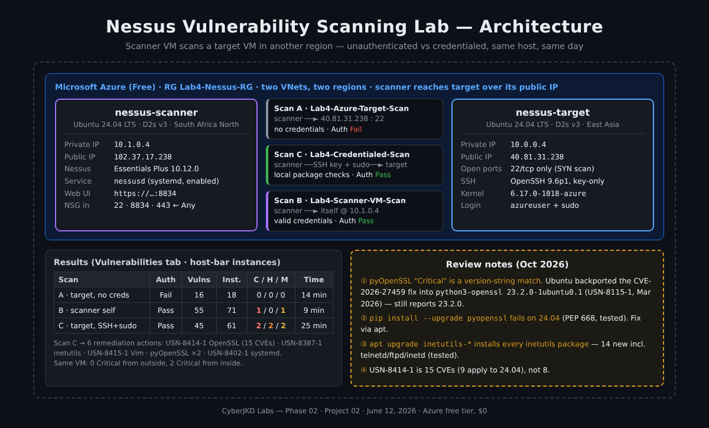

```
Azure (Free) · RG Lab4-Nessus-RG
│
├── nessus-scanner  (South Africa North · vnet 10.1.0.0 · 10.1.0.4)
│     └── nessusd  → Nessus Essentials Plus 10.12.0, Web UI :8834
│           │
│           ├── Scan A  Lab4-Azure-Target-Scan   ──► target public IP :22   no creds      Auth Fail
│           ├── Scan B  Lab4-Scanner-VM-Scan     ──► itself @ 10.1.0.4      valid creds   Auth Pass
│           └── Scan C  Lab4-Credentialed-Scan   ──► target public IP :22   SSH key+sudo  Auth Pass
│
└── nessus-target   (East Asia · vnet 10.0.0.0 · 10.0.0.4)
      └── only 22/tcp open · OpenSSH 9.6p1 (publickey auth only)
```

## Key Concepts

### CVE and CVSS
A **CVE** (Common Vulnerabilities and Exposures) is a unique ID assigned to a publicly disclosed vulnerability - e.g. `CVE-2026-27459`. A **CVSS** score (0-10) measures how severe it is: 9.0-10.0 is Critical, 7.0-8.9 is High, 4.0-6.9 is Medium, below 4.0 is Low. The score reflects how easy the vulnerability is to exploit and how much damage it can do.

### Unauthenticated vs credentialed scanning
- **Unauthenticated** - Nessus probes the target from the outside only: open ports, service banners, protocol versions. It cannot see what software is actually installed or how patched the system is.
- **Credentialed** - Nessus logs in over SSH and inspects the system from the inside: installed packages, exact versions, kernel patch level. This is how real vulnerabilities are found.

The gap between these two scan types is the single most important lesson of this lab.

### Auth status: Pass vs Fail
Every Nessus scan reports an **Auth** column per host. `Fail` means no credentials were used or they didn't work - findings are limited to INFO severity. `Pass` means Nessus successfully authenticated and ran local checks - this is when Critical and High findings appear.

### USN - Ubuntu Security Notices
Canonical publishes USNs (e.g. `USN-8414-1`) bundling multiple related CVEs into a single patch advisory. One `apt upgrade` can resolve dozens of CVEs covered by a single USN.

### Backported patches (added in review)
Ubuntu usually fixes a CVE by patching the *same* upstream version and bumping only the package revision (e.g. `23.2.0-1` → `23.2.0-1ubuntu0.1`). A scanner check that reads only the upstream version number cannot see that fix - which is why Nessus itself reports *Backported Security Patch Detection* in Scan A, and why [Review Note 1](#review-notes-october-2026) matters.

---

## Lab Walkthrough

### Stage 1 - Register for Nessus Essentials

Registered for Nessus Essentials Plus (US$0.00) on the Tenable store and received the activation code by email.

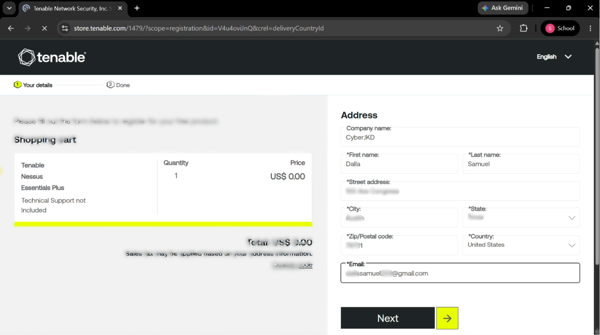

### Stage 2 - Deploy the two Azure VMs

- `nessus-scanner` - South Africa North, Standard D2s v3 (2 vCPU, 8 GiB), private IP 10.1.0.4
- `nessus-target` - East Asia, Standard D2s v3, private IP 10.0.0.4
- Both in Resource Group `Lab4-Nessus-RG`, each on its own VNet
- Scanner NSG inbound rules: 300 SSH (22), 310 Nessus-8834 (8834), 320 HTTPS (443)

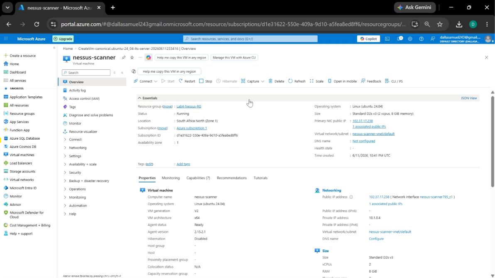
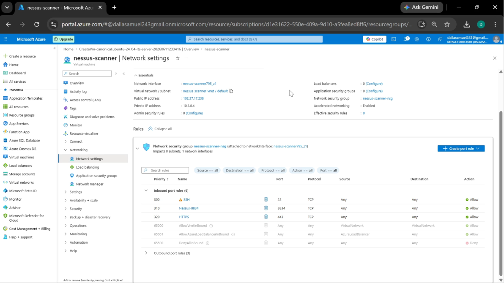
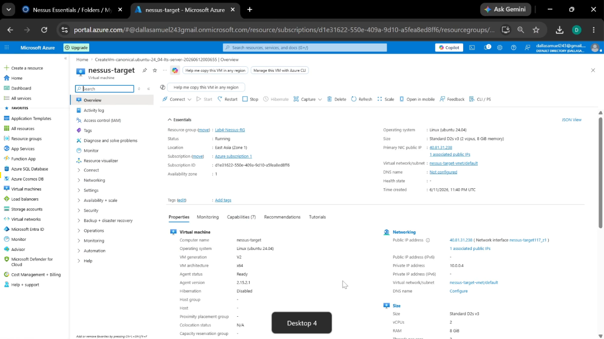

### Stage 3 - Install and start Nessus on the scanner

```bash
ssh azureuser@<scanner-public-ip>
sudo apt update && sudo apt upgrade -y
sudo dpkg -i <Nessus-10.12.0 .deb for Ubuntu>
sudo systemctl start nessusd
sudo systemctl enable nessusd
sudo systemctl status nessusd     # active (running)
```

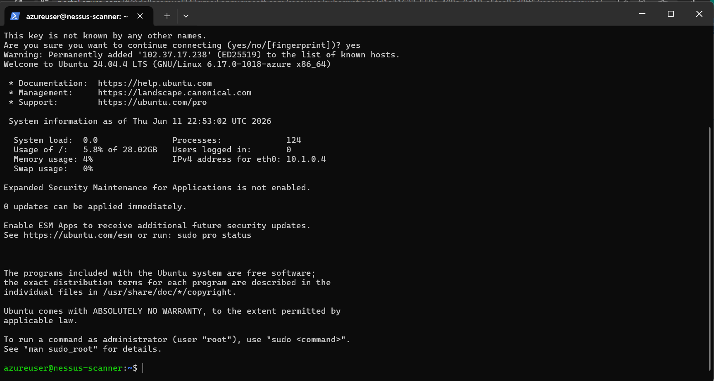
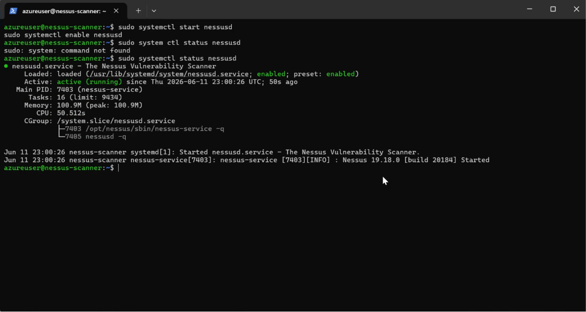

### Stage 4 - First login and plugin compile

Browsed to `https://<scanner-public-ip>:8834`, accepted the self-signed certificate warning, created the admin account, and waited for plugins to download and compile.

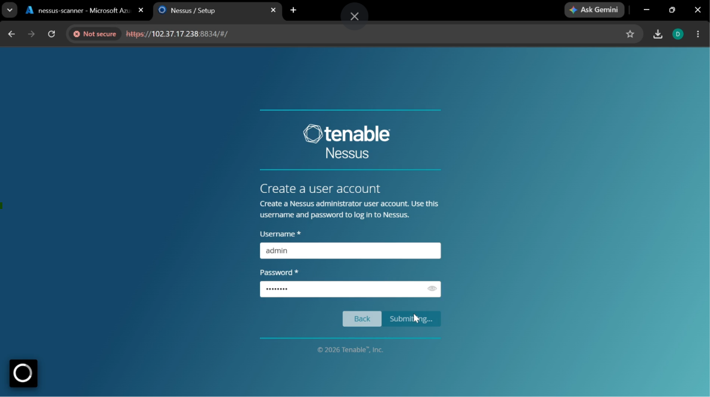
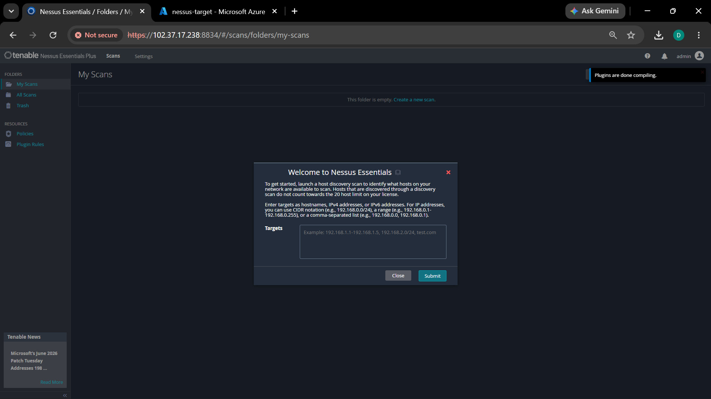

---

## Exercise A - Unauthenticated Scan (Lab4-Azure-Target-Scan)

**Objective:** Run a Basic Network Scan against the target VM's public IP with no credentials, and observe the limits of external-only scanning.

**Scan configuration:**
- Policy: Basic Network Scan
- Target: nessus-target public IP
- Credentials: none

**What I found:**

| Detail | Value |
|--------|-------|
| Auth status | Fail |
| Duration | 14 minutes |
| Total findings | 16 |
| Critical / High / Medium | 0 / 0 / 0 |
| Info | 16 |

All 16 findings were INFO severity - SSH protocol versions, OS fingerprinting, post-quantum cipher support, and an explicit "Target Credential Status: No Credentials Provided" flag confirming the scan type.

**Screenshot:**

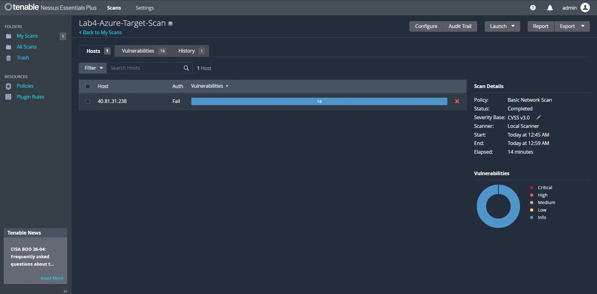

**Real-world application:** This is what an external attacker sees with zero access - port and service fingerprinting only. It's also what a perimeter-only vulnerability scan looks like, which is why compliance frameworks increasingly require credentialed scanning.

---

## Exercise B - Scanner VM Self-Scan (Lab4-Scanner-VM-Scan)

**Objective:** Scan the Nessus scanner VM itself via its private IP, where Nessus has local-host access by default.

**Scan configuration:**
- Policy: Basic Network Scan
- Target: nessus-scanner private IP (10.1.0.4)
- Credentials: local (self-scan) - see [Review Note 7](#review-notes-october-2026)

**What I found:**

| Detail | Value |
|--------|-------|
| Auth status | Pass |
| Duration | 9 minutes |
| Total findings | 71 |
| Critical | CVE-2026-27459 - pyOpenSSL Buffer Overflow |

**Headline finding:**

| CVE | CVSS | Description | Fix |
|-----|------|-------------|-----|
| CVE-2026-27459 | 9.8 (Critical) | pyOpenSSL 22.0.x < 26.0.0 - buffer overflow via oversized cookie callback | Upgrade pyOpenSSL to 26.0.0+ |

Also detected: 12 installations of Apache Log4j across the system (JndiLookup.class not present - Log4Shell exploit chain not applicable, but version unconfirmed and flagged for review).

**Screenshot:**

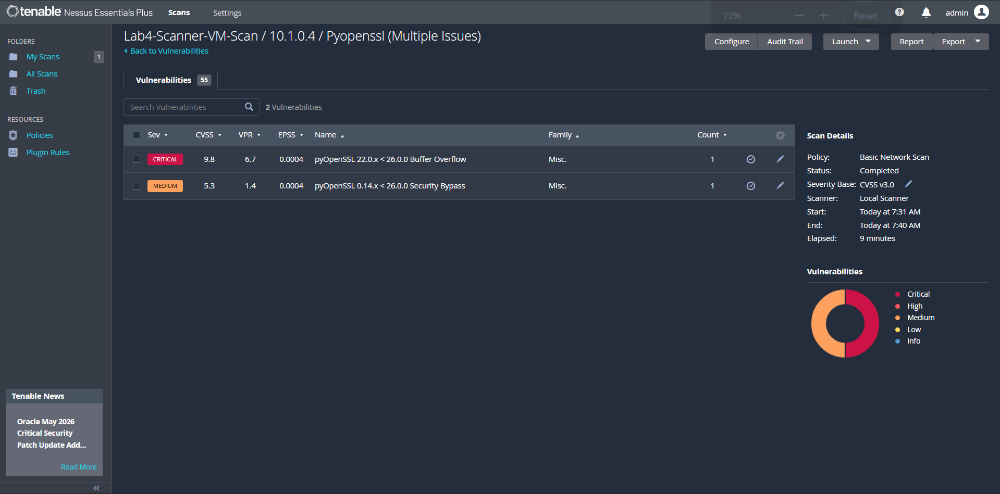

**Real-world application:** This is the scanner finding a vulnerability in its *own* host - a reminder that no system is exempt from scanning, including the security tooling itself.

---

## Exercise C - Credentialed Scan (Lab4-Credentialed-Scan)

**Objective:** Re-scan the target VM with SSH credentials and sudo privilege escalation, and compare results directly against Exercise A.

**Scan configuration:**
- Policy: Basic Network Scan
- Target: nessus-target public IP
- Credentials: SSH public key (azureuser) · Elevate privileges with sudo

**What I found:**

| Detail | Value |
|--------|-------|
| Auth status | Pass |
| Duration | 25 minutes |
| Total findings | 45 |
| Critical | 2 |
| High | 2 |
| Medium | 2 |
| Remediation actions generated | 6 |

**Critical findings:**

| CVE / Advisory | CVSS | Description | Fix |
|----------------|------|-------------|-----|
| USN-8414-1 (8 CVEs) | 9.1 | Ubuntu OpenSSL - heap buffer over-read, PKCS#12 integrity bypass, CMS auth bypass, QUIC NULL pointer derefs | `sudo apt upgrade openssl` |
| CVE-2026-27459 | 9.8 | pyOpenSSL Buffer Overflow (same as Exercise B, also present on target) | `pip install --upgrade pyopenssl` |

**High findings:**

| Advisory | CVSS | Description | Fix |
|----------|------|-------------|-----|
| USN-8387-1 | 7.8 | Ubuntu inetutils vulnerabilities | `sudo apt upgrade inetutils-*` |
| USN-8415-1 | 7.0 | Ubuntu Vim vulnerabilities | `sudo apt upgrade vim` |

> Review Notes [1](#review-notes-october-2026) (pyOpenSSL), [2](#review-notes-october-2026) (pip), [3](#review-notes-october-2026) (inetutils glob) and [4](#review-notes-october-2026) (USN-8414-1 CVE count) all apply to these two tables.

**Screenshot:**

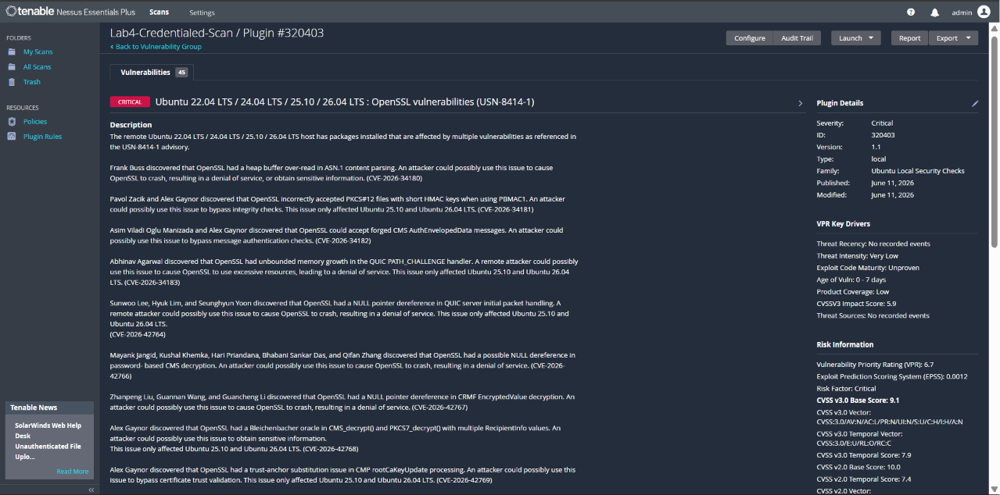

**Real-world application:** Same VM, same day - zero Critical findings without credentials, two Critical findings with them. This is the exact reason compliance frameworks (PCI-DSS, ISO 27001) mandate credentialed scanning, not just perimeter scanning.

---

## Unauthenticated vs Credentialed - Side by Side

| Metric | Unauthenticated (Exercise A) | Credentialed (Exercise C) |
|--------|------------------------------|----------------------------|
| Auth status | Fail | Pass |
| Total findings | 16 | 45 |
| Critical | 0 | 2 |
| High | 0 | 2 |
| Medium | 0 | 2 |
| CVEs identified | 0 | Multiple (USN-8414-1, USN-8387-1, USN-8415-1, CVE-2026-27459) |
| Remediation actions | 0 | 6 |
| Duration | 14 min | 25 min |

**Screenshot:**

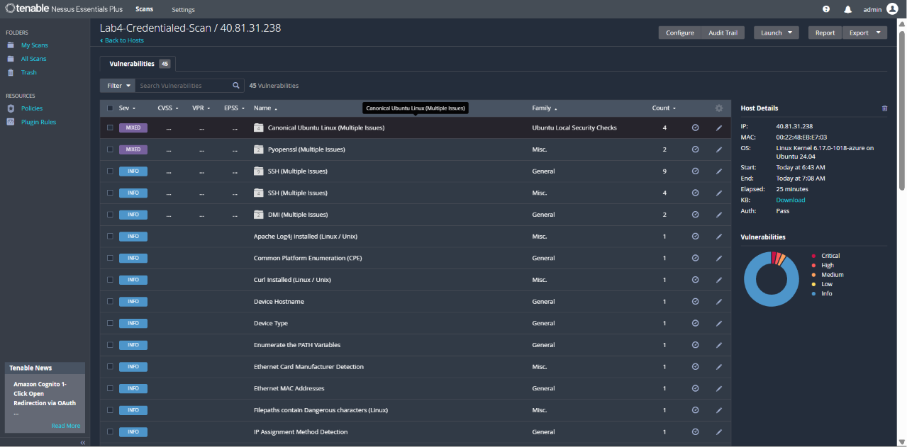

---

## Remediation Plan

| # | Action | Vulns fixed | Command |
|---|--------|-------------|---------|
| 1 | Update OpenSSL (USN-8414-1) | 15 | `sudo apt upgrade openssl` |
| 2 | Update inetutils (USN-8387-1) | 3 | `sudo apt upgrade inetutils-*` |
| 3 | Update Vim (USN-8415-1) | 2 | `sudo apt upgrade vim` |
| 4 | Upgrade pyOpenSSL - security bypass | 1 | `pip install --upgrade pyopenssl` |
| 5 | Upgrade pyOpenSSL - buffer overflow | 1 | `pip install --upgrade pyopenssl` |
| 6 | Update systemd (USN-8402-1) | 0 | `sudo apt upgrade systemd` |

**One-line fix for the target VM:**
```bash
sudo apt update && sudo apt upgrade -y
pip install --upgrade pyopenssl
```

> Tested in October 2026 on Ubuntu 24.04: the first line is the complete fix on its own. The second line fails on 24.04, and the inetutils command in row 2 installs extra packages - see [Review Notes 2 and 3](#review-notes-october-2026) and the corrected commands in the [Command Reference](#command-reference).

**Screenshot:**

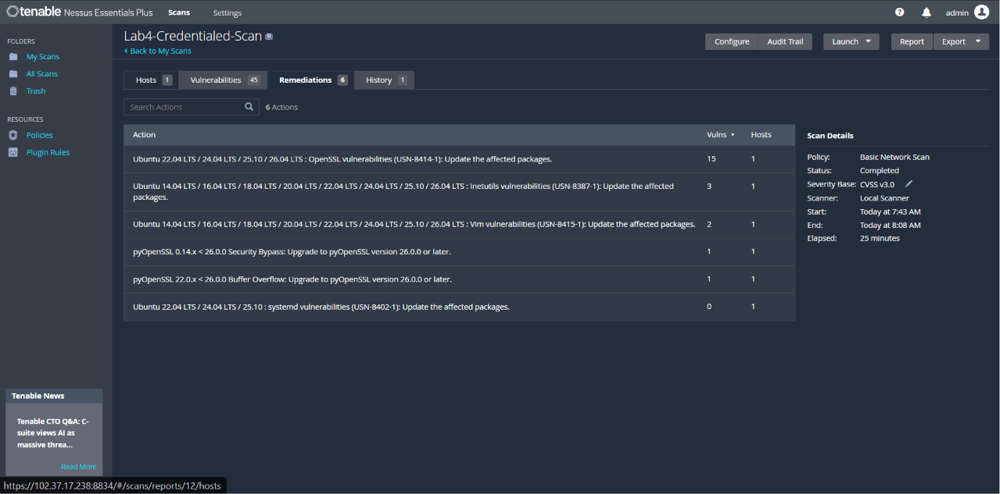

---

## Command Reference

| Command | Purpose |
|---------|---------|
| `sudo systemctl start nessusd` / `enable nessusd` | Start Nessus now and at every boot |
| `sudo systemctl status nessusd` | Confirm the scanner service is `active (running)` |
| `https://<scanner-ip>:8834` | Nessus Web UI (self-signed certificate) |
| `sudo apt update && sudo apt upgrade -y` | Apply every pending Ubuntu security update - fixes all 6 remediation actions |
| `sudo apt install --only-upgrade openssl libssl3t64` | Targeted fix for USN-8414-1 (the vulnerable code is in `libssl3t64`) |
| `sudo apt install --only-upgrade python3-openssl` | Correct pyOpenSSL fix on Ubuntu 24.04 (Review Note 2) |
| `dpkg -l 'inetutils-*' \| grep ^ii` | List the inetutils packages actually installed, then upgrade only those (Review Note 3) |
| `dpkg -l python3-openssl libssl3t64` | Verify the installed package *revision* - the number that proves a backported fix |
| `apt changelog python3-openssl \| head -20` | See which CVEs a package revision fixed |

## Verification Checklist

- [x] Registered for Nessus Essentials and activated with code
- [x] Deployed two Azure VMs (scanner + target) across regions
- [x] Installed and started nessusd via systemd on Ubuntu 24.04
- [x] Opened required NSG ports (22, 443, 8834) - *443 was not actually needed, see Review Note 8*
- [x] Ran unauthenticated Basic Network Scan
- [x] Ran self-scan on scanner VM (local Pass)
- [x] Configured SSH key + sudo credentials for credentialed scan
- [x] Identified and interpreted Critical/High CVEs with CVSS scores
- [x] Compared unauthenticated vs credentialed results
- [x] Generated and reviewed Nessus remediation actions
- [x] Logged remediation ticket in ServiceNow - *was ⬜ TODO here; completed in [Project 03](../project-03-servicenow-vulnerabiity-ticketing)*
- [ ] Every Critical is a real, exploitable gap: **no - the pyOpenSSL Critical is very likely a backport false positive, see Review Note 1**
- [ ] Every remediation command works as written on 24.04: **no - `pip` fails and the inetutils glob over-installs, see Review Notes 2 and 3**

## Review Notes (October 2026)

I came back to this lab after finishing Phase 02 and re-checked the README against all 42 screenshots, then actually ran the remediation commands on a fresh Ubuntu 24.04 machine and pulled the Ubuntu packages and advisories involved. The core lesson holds completely: the same VM showed **zero** Criticals from outside and a real Critical (USN-8414-1, OpenSSL) from inside. But testing turned up three things that a vulnerability-management interviewer would catch, plus some smaller corrections.

**1. The pyOpenSSL "Critical" (CVE-2026-27459) is very likely a false positive caused by a backported patch.** Ubuntu fixed this CVE - and CVE-2026-27448, which matches the "pyOpenSSL 0.14.x < 26.0.0 Security Bypass" Medium - in [USN-8115-1](https://ubuntu.com/security/notices/USN-8115-1) on **23 March 2026**, eleven weeks before these scans. The fix shipped as `python3-openssl 23.2.0-1ubuntu0.1`: the upstream version string stays **23.2.0**. I downloaded that package and confirmed its changelog lists both CVEs and its `SSL.py` now rejects over-long DTLS cookies. Meanwhile the Nessus plugin output (screenshot 41) says Nessus did not test for the issue and *"relied only on the application's self-reported version number"* - and the path it read was `pyOpenSSL-23.2.0.egg-info`. A version-only check cannot tell 23.2.0 from 23.2.0-ubuntu0.1. The strongest evidence: in Scan C, Ubuntu's own *Local Security Checks* (which do compare package revisions) flagged four USNs - 8414, 8387, 8415, 8402 - but **not** USN-8115-1, which means the target's package was already patched. What this changes: the target realistically had **1** genuine Critical (USN-8414-1), not 2, and the scanner self-scan's only Critical was this same false positive. How to confirm on a live box: `dpkg -l python3-openssl` - if it shows `23.2.0-1ubuntu0.1`, the finding is a false positive to document and accept (with evidence), not a patch to apply. This is the most valuable thing in the lab: knowing when *not* to trust a 9.8.

**2. `pip install --upgrade pyopenssl` fails on Ubuntu 24.04.** I ran it with Ubuntu's stock Python 3.12, as root and as a normal user. Both return `error: externally-managed-environment` (PEP 668) - Ubuntu 24.04 blocks pip from modifying system-wide Python packages because they belong to apt. Forcing it with `--break-system-packages` would overwrite the distro-managed copy and can break tools that depend on it. The correct fix is `sudo apt install --only-upgrade python3-openssl` - which, per Note 1, was already done.

**3. `sudo apt upgrade inetutils-*` installs every inetutils package, not just the vulnerable one.** On Ubuntu 24.04's apt 2.8, `apt upgrade <names>` *installs* any named package that is missing. I simulated the command on a clean 24.04 host: **14 packages newly installed**, including `inetutils-telnetd`, `inetutils-ftpd`, `inetutils-talkd` and `inetutils-inetd` - network servers - to fix a vulnerability in the client tools. A remediation that adds a telnet server enlarges the attack surface it was meant to shrink. The safe pattern: list what's installed with `dpkg -l 'inetutils-*'`, then `sudo apt install --only-upgrade <those packages>`, or just run the full `apt upgrade -y`. (I also tested `sudo apt upgrade openssl` by downgrading OpenSSL to the 24.04 release version: it *does* pull in the patched `libssl3t64` too, so that command is fine.)

**4. USN-8414-1 has 15 CVEs, not 8 - and 6 of them don't affect 24.04.** The [advisory](https://ubuntu.com/security/notices/USN-8414-1) (published 9 June 2026, two days before the scan) lists 15 CVEs, which matches Nessus's "15 vulns" in the Remediations tab and the Remediation Plan table above. Six of them - including the PKCS#12 bypass (CVE-2026-34181) and two of the QUIC NULL-pointer issues (CVE-2026-34183, CVE-2026-42764) named in the Critical table - affected **only Ubuntu 25.10 and 26.04**; screenshot 40 shows that wording. So 9 CVEs actually apply to the 24.04 target. The CVSS 9.1 and the fix (`openssl`/`libssl3t64` 3.0.13-0ubuntu3.11 or later) are correct.

**5. The Log4j "12 installations" are mostly not Log4j.** The first path Nessus listed (screenshot 37) is `/usr/share/java/libintl-0.21.jar`. I pulled it from Ubuntu's `gettext-base` package: it is GNU gettext's Java library - 2.6 KB, one class (`gnu/gettext/GettextResource.class`), zero Log4j code. Nessus matched it by "embedded string inspection" with version "unknown", and the package also creates several symlinks to the same jar, which inflates the count. The README was right to be cautious; the stronger conclusion is "false positive on at least the first path - verify the rest with `unzip -l` before raising any ticket".

**6. "Total findings" mixes two different Nessus counts.** Nessus shows a *Vulnerabilities tab* count (grouped plugins) and a *host bar* count (individual instances). Exercises A and C use the tab count (16, 45); Exercise B uses the host-bar count (71). On the same basis the three scans are **16 / 55 / 45** (tab) or **18 / 71 / 61** (instances). Scan B also had a Medium (pyOpenSSL Security Bypass, 5.3) alongside its Critical.

**7. Scan B was a credentialed scan, not a default local one.** Scanning `10.1.0.4` goes over the scanner's own network interface to SSH, not via a special local path - and Scan B's results include *"Target Credential Status by Authentication Protocol - Valid Credentials Provided"* (screenshot 35). So Exercise B's "local-host access by default" description doesn't match the evidence: credentials were configured for this scan too.

**8. Housekeeping.**
- `lab4-41-finding-pyopenssl-target.png` is actually from **Lab4-Scanner-VM-Scan / 10.1.0.4**, not the target. pyOpenSSL *was* flagged on the target too - screenshots 39 and 42 show it - just not in that image.
- `lab4-02-activation-code-email.png` shows the full Nessus activation code in a public repo. It's single-registration and the lab is torn down, but codes, tokens and keys should be blurred before committing, the same way the address in screenshot 01 was.
- The scanner NSG allowed 22, 8834 **and 443 from Any**. Nessus listens on 8834 only, so 443 had nothing behind it; and 8834/22 should have been restricted to my own IP rather than the whole internet - the [Splunk lab](../project-01-splunk-siem-lab) showed bots find open ports within hours.
- The info table says "Phase 02 · Project 05" while the badge and Connection to Roadmap say Project 02 - both mean this lab.
- The High CVSS values (USN-8387-1 at 7.8, USN-8415-1 at 7.0) aren't shown in any committed screenshot, so they're the one set of numbers here I couldn't re-check.
- The ServiceNow TODO in the checklist is done - [Project 03](../project-03-servicenow-vulnerabiity-ticketing) logged these findings as tickets.

## What I'd Change for Production

| Lab setup | Production reality |
|-----------|-------------------|
| Two standalone VMs, manually scanned | Production uses scheduled scans across asset groups via Nessus Manager / Tenable.io |
| Scanner and target on separate VNets, scanned via public IP | Production scanners sit inside the VNet and scan private ranges - no public exposure needed |
| SSH key uploaded manually per scan | Production stores credentials centrally in a credential vault (Azure Key Vault, CyberArk) |
| Findings reviewed manually in the UI | SOC teams export findings to a vulnerability management platform (Qualys, Tenable.io) with SLA tracking |
| No ticketing | Production remediation work is tracked in ServiceNow/Jira with assigned owners and due dates |
| One-off credentialed scan | Production runs continuous/scheduled scans to catch newly disclosed CVEs (like USN-8414-1, published the same week as this scan) |
| Every Critical treated as real | Triage step that checks the distro package revision before ticketing - version-only plugins vs distro backports (Review Note 1) |
| Fix commands written from plugin text | Remediation commands tested on a staging image first; `apt install --only-upgrade` with explicit package names (Review Notes 2, 3) |
| NSG open to Any on 22 / 8834 / 443 | Source restricted to the admin IP or Azure Bastion; only the ports the service actually uses (Review Note 8) |

## Connection to Roadmap

This lab is **Phase 02 · Project 02** of the [CyberJKD](https://dallasamuel.github.io/CyberJKD-Roadmap) Cloud Security Engineering roadmap - completing the Vulnerability Management mission objective.

The scanning and triage workflow built here transfers directly to:
- **Microsoft Defender for Cloud** - recommendation-based vulnerability assessment for Azure resources
- **[Phase 02 Project 01](../project-01-splunk-siem-lab)** - Splunk SIEM (this lab finds the weaknesses; Splunk detects when they're exploited)
- **ServiceNow ITSM** - logging and tracking the remediation ticket for the findings above (outstanding when this lab was written) - now done in **[Phase 02 Project 03](../project-03-servicenow-vulnerabiity-ticketing)**
- **Phase 04** - offensive security, where these same CVEs become exploitation targets in a controlled environment

<details>
<summary><b>All 42 screenshots (evidence index)</b></summary>

| # | Screenshot | # | Screenshot |
|---|---|---|---|
| 01 | [Tenable registration](screenshots/lab4-01-tenable-registration.png) | 22 | [Nessus Scan Information (v10.12.0)](screenshots/lab4-22-nessus-scan-information.png) |
| 02 | [Activation code email](screenshots/lab4-02-activation-code-email.png) | 23 | [SYN scanner - only 22/tcp open](screenshots/lab4-23-nessus-SYN-scanner.png) |
| 03 | [Scanner VM running](screenshots/lab4-03-nessus-scanner-vm-running.png) | 24 | [OpenSSH detection (9.6p1)](screenshots/lab4-24-openssh-detector.png) |
| 04 | [Scanner NSG rules](screenshots/lab4-04-nsg-rules-ports-open.png) | 25 | [OS fingerprints](screenshots/lab4-25-os-fingerprints-detected.png) |
| 05 | [Target VM running](screenshots/lab4-05-nessus-target-vm-running.png) | 26 | [OS identification](screenshots/lab4-26-os-identification.png) |
| 06 | [SSH to scanner](screenshots/lab4-06-ssh-connected-scanner.png) | 27 | [OS patch assessment not available](screenshots/lab4-27-os-security-patch-assessment-not-available.png) |
| 07 | [apt upgrade complete](screenshots/lab4-07-apt-update-complete.png) | 28 | [Post-quantum ciphers](screenshots/lab4-28-remote-services-using-post_quantum-ciphers.png) |
| 08 | [Nessus .deb install](screenshots/lab4-08-nessus-install-dpkg.png) | 29 | [Service detection](screenshots/lab4-29-service-detection.png) |
| 09 | [nessusd running](screenshots/lab4-09-nessusd-service-running.png) | 30 | [Shor's harvest-now-decrypt-later](screenshots/lab4-30-shor%27s-harvest-now-decrypt-later.png) |
| 10 | [Browser certificate warning](screenshots/lab4-10-browser-privacy-warning.png) | 31 | [SSH server type and version](screenshots/lab4-31-ssh-sever-type-and-service-information.png) |
| 11 | [Setup wizard](screenshots/lab4-11-nessus-setup-wizard.png) | 32 | [No credentials provided](screenshots/lab4-32-target-credential-status-by-authentiction-protocol.png) |
| 12 | [Plugins downloading](screenshots/lab4-12-plugins-compiling.png) | 33 | [TCP/IP timestamps](screenshots/lab4-33-tcpip-timestamps-supported.png) |
| 13 | [Plugins done](screenshots/lab4-13-plugins-done.png) | 34 | [Scan B completed](screenshots/lab4-34-scan2-completed-71-findings.png) |
| 14 | [Scan A configuration](screenshots/lab4-14-scan1-configuration.png) | 35 | [Scan B list (1)](screenshots/lab4-35-scan2-vulnerabilities-list.png) · [(2)](screenshots/lab4-35-scan2-vulnerabilities-list1.png) · [(3)](screenshots/lab4-35-scan2-vulnerabilities-list2.png) |
| 15 | [Scan A running](screenshots/lab4-15-scan1-running.png) | 36 | [pyOpenSSL Critical (scanner)](screenshots/lab4-36-finding-pyopenssl-critical.png) |
| 16 | [Scan A completed](screenshots/lab4-16-scan1-completed-16-findings.png) | 37 | [Log4j detection](screenshots/lab4-37-finding-log4j.png) |
| 17 | [Scan A vulnerabilities](screenshots/lab4-17-scan1-vulnerabilities-list.png) | 38 | [Scan C completed](screenshots/lab4-38-scan3-completed-45-findings.png) |
| 18 | [Backported patch detection](screenshots/lab4-18-finding-backported-ssh.png) | 39 | [Scan C vulnerabilities](screenshots/lab4-39-scan3-vulnerabilities-list.png) |
| 19 | [SSH protocol versions](screenshots/lab4-19-finding-ssh-protocol-versions.png) | 40 | [USN-8414-1 OpenSSL Critical](screenshots/lab4-40-finding-openssl-critical.png) |
| 20 | [CPE](screenshots/lab4-20-common-platform-enumeration%28CPE%29.png) | 41 | [pyOpenSSL plugin detail (scanner - Note 8)](screenshots/lab4-41-finding-pyopenssl-target.png) |
| 21 | [Device type](screenshots/lab4-21-device-type.png) | 42 | [Remediations tab](screenshots/lab4-42-remediations-tab.png) |

</details>

---

🌐 Full roadmap: [dallasamuel.github.io/CyberJKD-Roadmap](https://dallasamuel.github.io/CyberJKD-Roadmap)

🔗 All labs: [github.com/DallaSamuel/CyberJKD-Labs](https://github.com/DallaSamuel/CyberJKD-Labs)

---

*CyberJKD - Becoming dangerous through fundamentals. 🔒*
