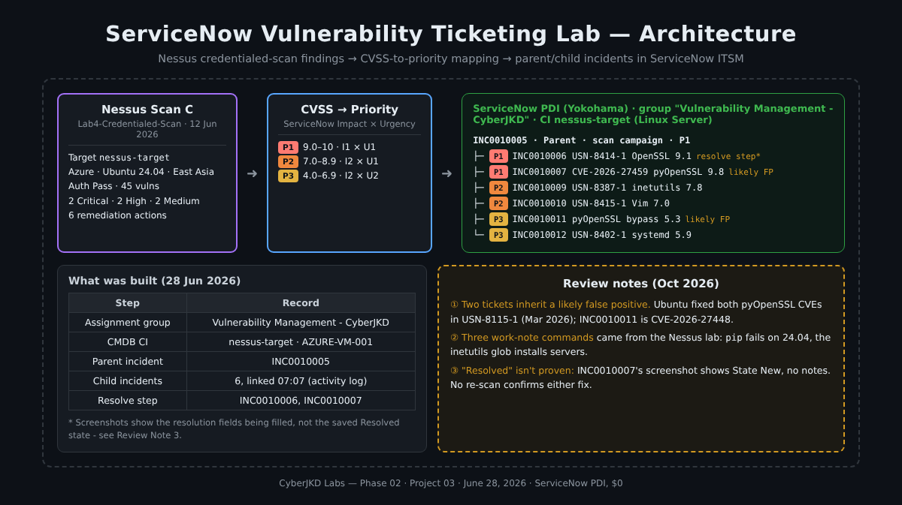
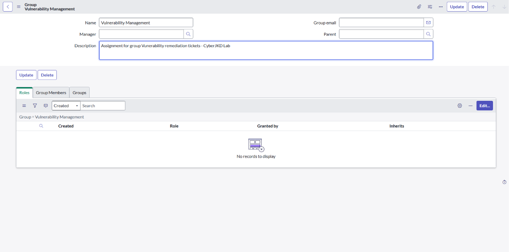
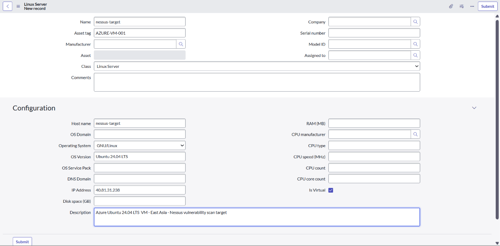
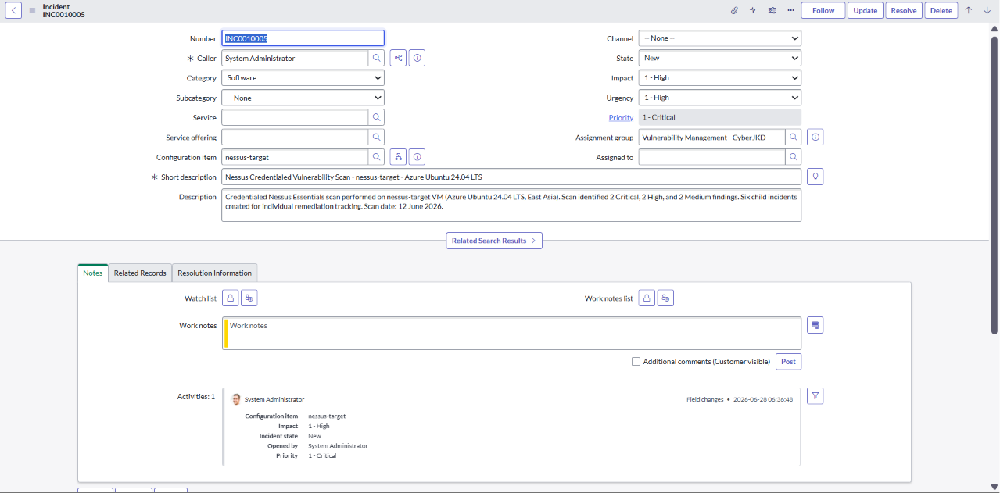
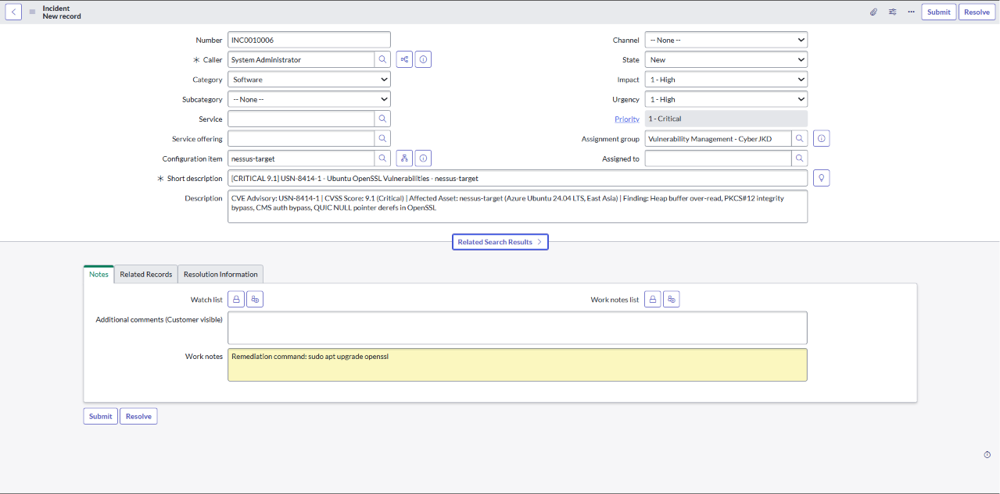
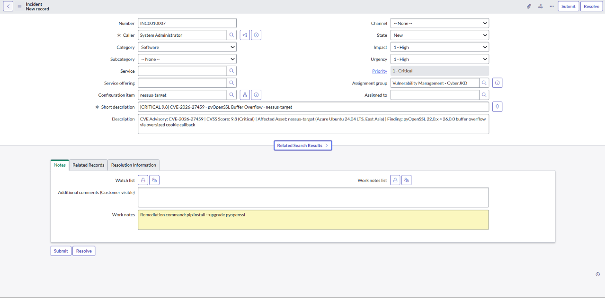
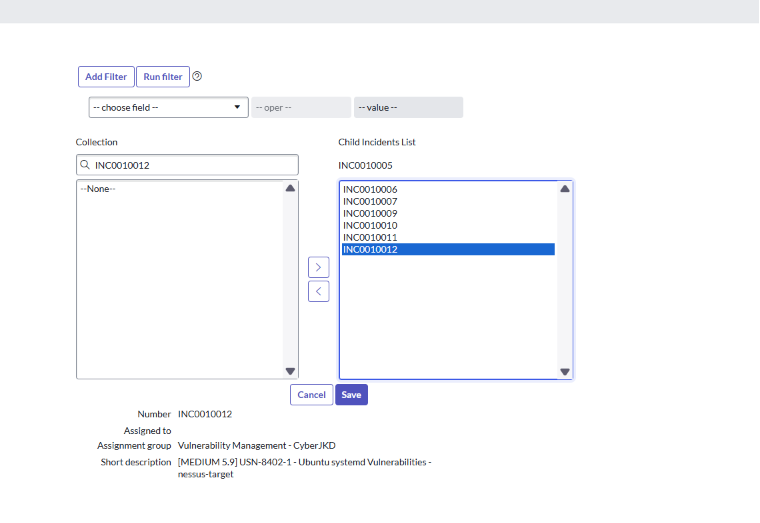
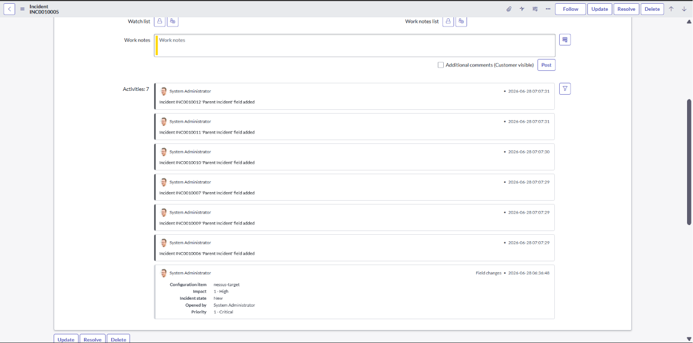
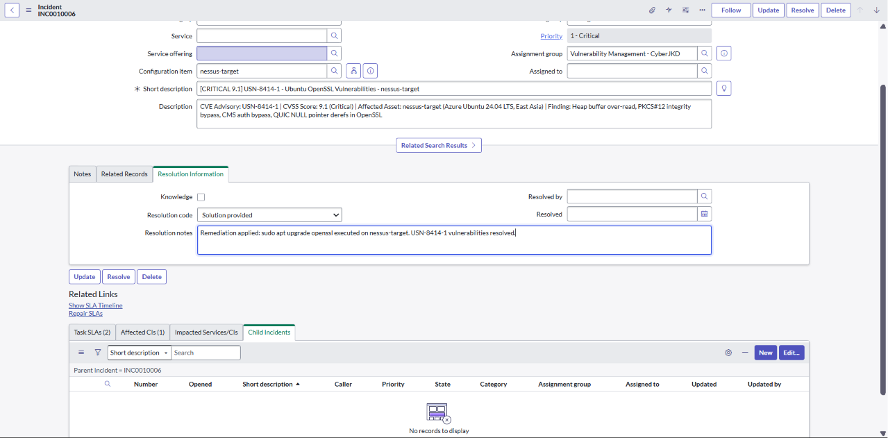
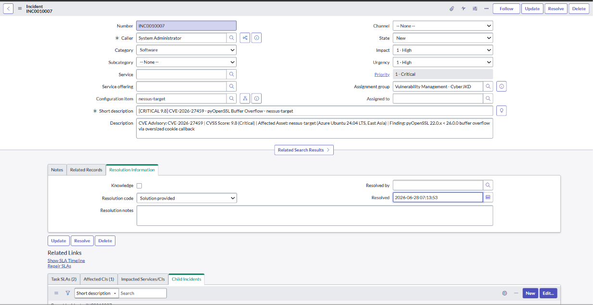

# ServiceNow Vulnerability Ticketing Lab


| | |
|---|---|
| **Author** | Dalla Samuel (CyberJKD) |
| **Date** | June 28, 2026 |
| **Platform** | ServiceNow Personal Developer Instance (PDI) - dev218480.service-now.com |
| **Lab Source** | CloudTechExec - 5 Labs To Get You Hired · Vulnerability Management |
| **Roadmap** | [Phase 02 · Project 03](https://dallasamuel.github.io/CyberJKD-Roadmap) |

---

## Objective

Log, triage, and track remediation of 6 real vulnerabilities discovered during a Nessus credentialed scan ([Phase 02 · Project 02](../project-02-nessus-vulnerability-scanning)) using ServiceNow ITSM - following enterprise-grade incident management practices with a parent/child ticket structure, CMDB CI registration, and CVSS-to-priority mapping.

## Business Problem This Lab Solves

Finding vulnerabilities is only half the job. The other half is tracking them to resolution.

Without a ticketing system, vulnerability findings get lost - no owner, no due date, no audit trail. This lab bridges the gap between a scanner output and an enterprise remediation workflow, which is exactly what a Cloud Security Engineer or Vulnerability Management Analyst does in production.

| Role | How this applies |
|---|---|
| Vulnerability Management Analyst | Log findings, assign priority, track SLA to resolution |
| Cloud Security Engineer | Same workflow applies to Azure Defender for Cloud recommendations |
| SOC Analyst | Escalate active CVEs as incidents with structured triage |
| IT Operations | Receive assigned tickets with remediation commands and execute |

## Environment

| Component | Detail |
|---|---|
| Platform | ServiceNow Personal Developer Instance (PDI) |
| Instance | dev218480.service-now.com |
| Version | Yokohama |
| Role | Admin |
| Source data | Nessus credentialed scan - nessus-target (Azure Ubuntu 24.04 LTS, East Asia) |

## Key Concepts

### Incident, parent and child
An **incident** is ServiceNow's record for something that needs fixing. A **parent incident** groups related work - here, one scan campaign - and each **child incident** tracks a single finding with its own priority, owner and resolution. Closing the children one by one gives an audit trail per vulnerability while the parent shows campaign progress.

### CMDB and Configuration Items
The **CMDB** (Configuration Management Database) is ServiceNow's inventory. Each server, VM or app is a **Configuration Item (CI)**. Linking incidents to the `nessus-target` CI means anyone looking at that VM's record can see every open vulnerability against it.

### Priority = Impact × Urgency
ServiceNow doesn't let you type a priority directly - it calculates it from **Impact** (how much damage) and **Urgency** (how fast it must be fixed). This lab maps CVSS severity onto those two fields so priority follows the scanner's risk score consistently, instead of being a judgement call per ticket.

### Resolved vs closed (added in review)
In ServiceNow, **Resolved** means the fix team says it's done; **Closed** comes later, after confirmation. In vulnerability management, the confirmation is a **re-scan** showing the finding is gone - see [Review Note 3](#review-notes-october-2026).

## Architecture



```
Nessus Scan C (Lab4-Credentialed-Scan, 12 Jun 2026) ── 6 remediation actions
        │
        ▼  CVSS → Impact × Urgency → Priority
ServiceNow PDI (Yokohama)
   ├── Group: Vulnerability Management - CyberJKD
   ├── CMDB CI: nessus-target (Linux Server, AZURE-VM-001)
   └── INC0010005  Parent - scan campaign (P1)
         ├── 6 child incidents, one per finding (P1 ×2, P2 ×2, P3 ×2)
         └── resolve step on INC0010006 + INC0010007
```

---

## CVSS Priority Mapping Framework

| CVSS Score | Severity | Impact | Urgency | ServiceNow Priority |
|---|---|---|---|---|
| 9.0 - 10.0 | Critical | 1 - High | 1 - High | 1 - Critical |
| 7.0 - 8.9 | High | 2 - Medium | 1 - High | 2 - High |
| 4.0 - 6.9 | Medium | 2 - Medium | 2 - Medium | 3 - Moderate |

These combinations match ServiceNow's default priority lookup (1×1 → 1, 2×1 → 2, 2×2 → 3), so the calculated Priority field lands where the table says.

## Findings Logged

| INC Number | CVSS | Severity | Advisory / CVE | Package | Remediation |
|------------|------|----------|----------------|---------|-------------|
| INC0010006 | 9.1 | Critical | USN-8414-1 | Ubuntu OpenSSL | `sudo apt upgrade openssl` |
| INC0010007 | 9.8 | Critical | CVE-2026-27459 | pyOpenSSL Buffer Overflow | `pip install --upgrade pyopenssl` |
| INC0010009 | 7.8 | High | USN-8387-1 | Ubuntu inetutils | `sudo apt upgrade inetutils-*` |
| INC0010010 | 7.0 | High | USN-8415-1 | Ubuntu Vim | `sudo apt upgrade vim` |
| INC0010011 | 5.3 | Medium | N/A | pyOpenSSL Security Bypass | `pip install --upgrade pyopenssl` |
| INC0010012 | 5.9 | Medium | USN-8402-1 | Ubuntu systemd | `sudo apt upgrade systemd` |

> Review Notes [1 and 2](#review-notes-october-2026) apply to this table: INC0010011's advisory is CVE-2026-27448, both pyOpenSSL tickets are very likely false positives, and the `pip` and `inetutils-*` commands don't work as intended on Ubuntu 24.04.

## Ticket Structure

```
INC0010005 - Parent Incident (Nessus Scan Campaign)
├── INC0010006 - [CRITICAL 9.1] USN-8414-1 Ubuntu OpenSSL
├── INC0010007 - [CRITICAL 9.8] CVE-2026-27459 pyOpenSSL Buffer Overflow
├── INC0010009 - [HIGH 7.8] USN-8387-1 Ubuntu inetutils
├── INC0010010 - [HIGH 7.0] USN-8415-1 Ubuntu Vim
├── INC0010011 - [MEDIUM 5.3] pyOpenSSL Security Bypass
└── INC0010012 - [MEDIUM 5.9] USN-8402-1 Ubuntu systemd
```

---

## Lab Walkthrough

### Stage 1 - Assignment Group

Created assignment group: **Vulnerability Management - CyberJKD**

`User Administration → Groups → New`



### Stage 2 - CMDB CI Registration

Registered nessus-target VM as a Linux Server CI:

| Field | Value |
|---|---|
| Name | nessus-target |
| OS | GNU/Linux · Ubuntu 24.04 LTS |
| IP Address | 40.81.31.238 |
| Is Virtual | ✅ |
| Asset Tag | AZURE-VM-001 |
| Description | Azure Ubuntu 24.04 LTS VM - East Asia - Nessus vulnerability scan target |



### Stage 3 - Parent Incident

Created parent incident **INC0010005** to represent the overall scan campaign:

| Field | Value |
|---|---|
| Short description | Nessus Credentialed Vulnerability Scan - nessus-target - Azure Ubuntu 24.04 LTS |
| Category | Software |
| Impact | 1 - High |
| Urgency | 1 - High |
| Priority | 1 - Critical |
| Assignment group | Vulnerability Management - CyberJKD |
| Configuration Item | nessus-target |



### Stage 4 - 6 Child Incidents

Created one incident per finding with CVSS-mapped priority, CVE details in Description, and remediation command in Work Notes.





### Stage 5 - Parent/Child Linking

Linked all 6 child incidents to INC0010005 via the Child Incidents related list.





### Stage 6 - Resolve 2 Tickets

Resolved INC0010006 and INC0010007 with resolution code **Solution provided** and remediation notes.





---

## Command Reference

| Where / command | Purpose |
|---|---|
| `User Administration → Groups → New` | Create the assignment group |
| `Configuration → Servers → Linux` (table `cmdb_ci_linux_server`) | Register the VM as a Linux Server CI |
| `Incident → Create New` | Parent and child incidents |
| Child Incidents related list → **Edit…** | Attach children to the parent (slushbucket picker, screenshot 06) |
| Incident list filter `Parent Incident = INC0010005` | See the whole campaign in one list |
| **Resolve** button + Resolution Information tab | Resolution code and notes are mandatory before the state changes to Resolved |
| `sudo apt update && sudo apt upgrade -y` | Fixes every apt-based ticket here in one go |
| `sudo apt install --only-upgrade python3-openssl` | Correct pyOpenSSL fix on Ubuntu 24.04 (replaces the `pip` work note) |
| `dpkg -l 'inetutils-*' \| grep ^ii` then `apt install --only-upgrade <those>` | Safe inetutils fix (replaces the `inetutils-*` glob) |
| `dpkg -l python3-openssl` | Evidence for closing the pyOpenSSL tickets as false positives (`23.2.0-1ubuntu0.1` = patched) |

## Verification Checklist

- [x] Assignment group created - Vulnerability Management - CyberJKD
- [x] nessus-target CI registered in CMDB
- [x] Parent incident created (INC0010005)
- [x] 6 child incidents created with CVSS-mapped priority
- [x] All 6 children linked to parent via Child Incidents tab
- [x] 2 tickets resolved with resolution code and notes - *screenshots show the resolve step in progress, see Review Note 3*
- [x] Screenshots captured
- [x] YouTube silent walkthrough
- [x] Viewer guide (.docx)
- [ ] Every ticket is a real, fixable gap: **no - INC0010007 and INC0010011 are very likely false positives, see Review Note 1**
- [ ] Resolutions confirmed by a re-scan: **no - see Review Note 3**

## Review Notes (October 2026)

I re-checked this lab against its 9 screenshots after re-testing the [Nessus lab](../project-02-nessus-vulnerability-scanning) it's built on. The ITSM side is solid: the parent/child structure, CI linking and priority matrix are all correct and the activity log proves the six links (screenshot 07). The issues are almost all inherited from the scan data - which is exactly what happens in real vulnerability management, and why triage has to come before ticketing.

**1. Two tickets are very likely false positives - and INC0010011 does have a CVE.** Ubuntu fixed both pyOpenSSL issues in [USN-8115-1](https://ubuntu.com/security/notices/USN-8115-1) on 23 March 2026, by backporting the patch into `python3-openssl 23.2.0-1ubuntu0.1`. The version string stays 23.2.0, and Nessus's pyOpenSSL plugins only read that string. Ubuntu's own package checks in the same Nessus scan didn't flag USN-8115-1, which means the target was already patched. So INC0010007 (CVE-2026-27459) and INC0010011 are false positives, and INC0010011's "N/A" advisory is **CVE-2026-27448** (same USN). The right ServiceNow outcome isn't "Solution provided"; it's closing them as false positives with evidence attached (`dpkg -l python3-openssl` showing `ubuntu0.1`). Full detail and testing in [Nessus Review Note 1](../project-02-nessus-vulnerability-scanning#review-notes-october-2026).

**2. Three work-note commands don't do what the tickets say.** These came straight from the Nessus remediation plan, and I tested them on Ubuntu 24.04:
- `pip install --upgrade pyopenssl` (INC0010007, INC0010011) fails with `externally-managed-environment` (PEP 668).
- `sudo apt upgrade inetutils-*` (INC0010009) newly installs 14 packages, including the telnet, FTP and inetd **servers**.
- The INC0010006 description lists "PKCS#12 integrity bypass" and "QUIC NULL pointer derefs". In [USN-8414-1](https://ubuntu.com/security/notices/USN-8414-1) those CVEs only affect Ubuntu 25.10 and 26.04, not this 24.04 target. The advisory has 15 CVEs, 9 of which apply to 24.04.

A ticket's work note is what an IT Ops engineer will copy and paste, so it needs to be right. Corrected commands are in the [Command Reference](#command-reference).

**3. The screenshots don't show a completed resolve, and nothing re-scanned.**
- In screenshot 08 (INC0010006), the resolution notes are still being typed (cursor in the box), "Resolved" and "Resolved by" are empty, and the Resolve button is still on the form.
- In screenshot 09 (INC0010007), **State is New** and the resolution notes box is **empty**. ServiceNow requires notes before Resolve, so this is the form before resolving.

The tickets may well have been resolved after these screenshots; they just don't show it. Separately, the INC0010006 note says the upgrade was executed on nessus-target on 28 June, but there's no command output and no follow-up Nessus scan in this lab or the Nessus one. In production, "Resolved" is backed by a re-scan showing the finding gone before the ticket is Closed.

**4. Assignment group: name and members.** Screenshot 01 shows the group named "Vulnerability Management", but every incident shows "Vulnerability Management - CyberJKD", so it was renamed after that screenshot. The group also has no members, and "Assigned to" is empty on every ticket. That's fine for a single-admin PDI, but it means the tickets route to a group nobody is in.

**5. Housekeeping.**
- Screenshot 02 is the CI form before Submit. The CI clearly exists, because every incident references `nessus-target`.
- Incident numbers jump from INC0010007 to INC0010009. ServiceNow never reuses numbers, so INC0010008 was probably a ticket started and abandoned.
- The 🎥 link text says `youtube.com/@CyberJKD` but points to this lab's video (which works), not the channel.
- The CVSS values for the High and Medium tickets (7.8, 7.0, 5.9) come from Nessus screens that aren't in either lab's screenshots, so I couldn't re-check them. Nessus's Remediations tab listed the systemd action with "0" vulns even though it's logged here as a 5.9 Medium.

## What I'd Change for Production

| Lab setup | Production reality |
|---|---|
| Manually created tickets | Auto-ingestion from Tenable.io / Defender for Cloud via integration |
| Admin resolving own tickets | Tickets assigned to patching team with SLA enforcement |
| PDI with demo data | Production ServiceNow with CMDB populated via Service Graph Connector |
| Manual CI entry | CI auto-discovered via Azure Arc or ServiceNow Discovery |
| No change management | Critical patches go through CAB approval before deployment |
| Every scanner finding becomes a ticket | Triage first: check distro backports and applicability, close false positives with evidence (Review Note 1) |
| Remediation commands copied from plugin text | Commands tested on a staging image before going into work notes (Review Note 2) |
| Resolved on the fixer's word | Resolved → re-scan confirms → Closed; the scanner closes the loop (Review Note 3) |
| Group with no members | Group with an on-call rotation and a named assignee per ticket (Review Note 4) |

## Connection to Roadmap

This lab is **Phase 02 · Project 03** of the CyberJKD Cloud Security Engineering roadmap - completing the ITSM/ticketing layer of the Vulnerability Management mission.

The workflow built here transfers directly to:
- **Microsoft Defender for Cloud** - recommendations become tickets with owners and SLAs
- **[Phase 02 · Project 02 (Nessus)](../project-02-nessus-vulnerability-scanning)** - this lab tracks what Nessus found to resolution
- **[Phase 02 · Project 01 (Splunk)](../project-01-splunk-siem-lab)** - completes the detect → assess → ticket loop
- **Phase 04** - offensive labs, where these same CVEs become exploitation targets

---

🌐 Full roadmap: [dallasamuel.github.io/CyberJKD-Roadmap](https://dallasamuel.github.io/CyberJKD-Roadmap)

🔗 All labs: [github.com/DallaSamuel/CyberJKD-Labs](https://github.com/DallaSamuel/CyberJKD-Labs)

🎥 Full walkthrough: [youtube.com/@CyberJKD](https://youtu.be/82MuDTjKlh0)

📄 Viewer Guide (follow along): [ServiceNow Ticketing Lab Viewer Guide](https://tinyurl.com/ServiceNow-Ticketing-Lab)

---

*CyberJKD - Becoming dangerous through fundamentals. 🔒*
