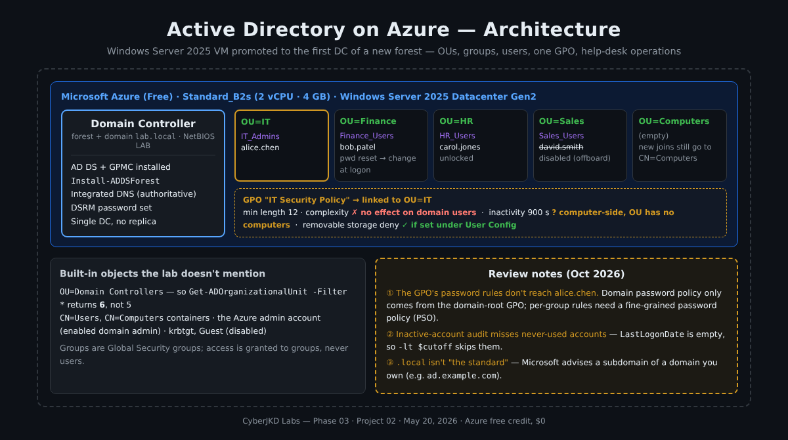

# Active Directory Lab - Enterprise Identity Environment from Scratch


| | |
|---|---|
| **Author** | Dalla Samuel (CyberJKD) |
| **Date** | May 20, 2026 |
| **Platform** | Windows Server 2025 · Azure Free Account (Standard_B2s VM) |
| **Lab Source** | CloudTechExec - 5 Labs To Get You Hired · Lab 1 |
| **Roadmap** | [Phase 03 · Project 03](https://dallasamuel.github.io/CyberJKD-Roadmap) (see [Review Note 8](#review-notes-october-2026)) |

---

## Objective

Build a complete Active Directory environment from scratch on Azure - promoting a Windows Server 2025 VM to a Domain Controller, structuring departments as Organisational Units, creating users and security groups, enforcing Group Policy, and performing common help desk tasks - using both GUI and PowerShell automation.

## Business Problem This Lab Solves

Every organisation running Windows infrastructure relies on Active Directory to answer one fundamental question: **who is allowed to do what?**

Active Directory is the identity backbone. It controls which users can log into which machines, which groups access which resources, and which policies apply to which departments. When a new employee joins, IT creates their account and adds them to the right groups - access is granted automatically. When they leave, IT disables one account and every door closes simultaneously.

This is not legacy technology. Hybrid environments sync on-premises AD to Microsoft Entra ID in the cloud. Understanding AD is foundational knowledge that transfers directly to cloud roles.

## Environment

| Component | Detail |
|---|---|
| Cloud Platform | Microsoft Azure (Free Account) |
| VM Size | Standard_B2s - 2 vCPU, 4GB RAM |
| OS | Windows Server 2025 Datacenter Gen2 |
| Domain | lab.local (NetBIOS `LAB`) |
| Cost | $0 - fully within free tier (see [Review Note 8](#review-notes-october-2026)) |

## Key Concepts

### Forest, domain and Domain Controller
A **forest** is the top-level security boundary in AD; a **domain** (`lab.local`) is the unit that holds users, groups and computers; a **Domain Controller** is the server that stores the directory and answers logons. `Install-ADDSForest` creates all three at once on a fresh server.

### OUs vs groups
**Organisational Units** are folders for *administration and policy* - you link GPOs to them and delegate admin rights over them. **Security groups** are for *access* - you grant permissions to groups, then add users. An OU doesn't grant access to anything; a group doesn't receive GPOs on its own.

### Group Policy scope (added in review)
A GPO applies to the user and computer objects **inside** the OU it's linked to - user-side settings to users, computer-side settings to computers. One important exception: **password and account-lockout policy for domain accounts** is read only from the GPO at the domain root. Linking those settings to an OU affects only *local* accounts on computers in that OU. Per-group password rules need a **Fine-Grained Password Policy** instead - see [Review Note 1](#review-notes-october-2026).

### Built-in objects
A new domain already contains the `Domain Controllers` OU (where the DC lives), the `CN=Users` and `CN=Computers` default containers, the built-in admin account (on Azure, the admin account you created for the VM, now a Domain Admin) and disabled `krbtgt` and `Guest` accounts. These show up in "list everything" queries.

## Architecture



```
Azure (Free) · Standard_B2s · Windows Server 2025 Datacenter Gen2
└── Domain Controller  (AD DS + DNS + GPMC)
      forest/domain: lab.local  ·  NetBIOS: LAB
      ├── OU=Domain Controllers   (built-in - the DC itself)
      ├── OU=IT        ── IT_Admins      ── alice.chen      ◄── GPO "IT Security Policy"
      ├── OU=Finance   ── Finance_Users  ── bob.patel       (password reset, change at logon)
      ├── OU=HR        ── HR_Users       ── carol.jones     (unlocked)
      ├── OU=Sales     ── Sales_Users    ── david.smith     (disabled - offboarding)
      └── OU=Computers    (empty - new joins still land in CN=Computers, Review Note 6)
```

---

## What Was Built

### Domain Controller

- Promoted Windows Server 2025 to Domain Controller
- Created new Active Directory forest: `lab.local`
- Configured DNS - server is now authoritative DNS for the domain
- Set DSRM password for disaster recovery

### Organisational Unit Structure

5 OUs created to mirror enterprise department structure:

| OU | Purpose |
|---|---|
| IT | IT department users and admins |
| Finance | Finance department users |
| HR | Human Resources users |
| Sales | Sales department users |
| Computers | Domain-joined workstations |

### Security Groups

Role-based access control through group membership:

| Group | OU | Members |
|---|---|---|
| IT_Admins | IT | alice.chen |
| Finance_Users | Finance | bob.patel |
| HR_Users | HR | carol.jones |
| Sales_Users | Sales | david.smith |

### User Accounts

4 users created with enterprise naming convention (`firstname.lastname`):

| User | Department | UPN |
|---|---|---|
| alice.chen | IT | alice.chen@lab.local |
| bob.patel | Finance | bob.patel@lab.local |
| carol.jones | HR | carol.jones@lab.local |
| david.smith | Sales | david.smith@lab.local |

### Group Policy Object - IT Security Policy

Applied to the IT OU - enforces the following settings centrally:

| Policy | Setting | Reason |
|---|---|---|
| Minimum password length | 12 characters | Enforces strong passwords |
| Password complexity | Enabled | Requires upper, lower, number, symbol |
| Screen lock inactivity | 900 seconds (15 min) | Auto-locks unattended machines |
| Removable storage access | Deny all | Prevents USB data exfiltration |

> [Review Notes 1 and 2](#review-notes-october-2026): the two password rows don't apply to domain users from an OU-linked GPO, and the inactivity row only applies to computers in the OU.

### Help Desk Tasks Practised

- Password reset with forced change on next login
- Account unlock after lockout
- Account disable for offboarding (preserves audit history)
- Inactive account audit - accounts not logged in for 90 days
- Group membership reporting

---

## Key PowerShell Commands Used

```powershell
# Install AD DS role
Install-WindowsFeature -Name AD-Domain-Services -IncludeManagementTools

# Install Group Policy Management Console
Install-WindowsFeature -Name GPMC

# Promote server to Domain Controller
Install-ADDSForest -DomainName 'lab.local' -DomainNetBiosName 'LAB' `
  -InstallDns:$true `
  -SafeModeAdministratorPassword (ConvertTo-SecureString 'YourDSRMPassword!' -AsPlainText -Force) `
  -Force:$true

# Create all 5 OUs
New-ADOrganizationalUnit -Name "IT"        -Path "DC=lab,DC=local"
New-ADOrganizationalUnit -Name "Finance"   -Path "DC=lab,DC=local"
New-ADOrganizationalUnit -Name "HR"        -Path "DC=lab,DC=local"
New-ADOrganizationalUnit -Name "Sales"     -Path "DC=lab,DC=local"
New-ADOrganizationalUnit -Name "Computers" -Path "DC=lab,DC=local"

# Create all 4 security groups
New-ADGroup -Name "IT_Admins"     -GroupScope Global -GroupCategory Security -Path "OU=IT,DC=lab,DC=local"
New-ADGroup -Name "Finance_Users" -GroupScope Global -GroupCategory Security -Path "OU=Finance,DC=lab,DC=local"
New-ADGroup -Name "HR_Users"      -GroupScope Global -GroupCategory Security -Path "OU=HR,DC=lab,DC=local"
New-ADGroup -Name "Sales_Users"   -GroupScope Global -GroupCategory Security -Path "OU=Sales,DC=lab,DC=local"

# Create all 4 users
$password = ConvertTo-SecureString "Welcome@2026!" -AsPlainText -Force

New-ADUser -Name "alice.chen"  -GivenName "Alice" -Surname "Chen" `
  -SamAccountName "alice.chen" -UserPrincipalName "alice.chen@lab.local" `
  -Path "OU=IT,DC=lab,DC=local" -AccountPassword $password -Enabled $true

New-ADUser -Name "bob.patel"   -GivenName "Bob" -Surname "Patel" `
  -SamAccountName "bob.patel"  -UserPrincipalName "bob.patel@lab.local" `
  -Path "OU=Finance,DC=lab,DC=local" -AccountPassword $password -Enabled $true

New-ADUser -Name "carol.jones" -GivenName "Carol" -Surname "Jones" `
  -SamAccountName "carol.jones" -UserPrincipalName "carol.jones@lab.local" `
  -Path "OU=HR,DC=lab,DC=local" -AccountPassword $password -Enabled $true

New-ADUser -Name "david.smith" -GivenName "David" -Surname "Smith" `
  -SamAccountName "david.smith" -UserPrincipalName "david.smith@lab.local" `
  -Path "OU=Sales,DC=lab,DC=local" -AccountPassword $password -Enabled $true

# Add each user to their department group
Add-ADGroupMember -Identity "IT_Admins"     -Members "alice.chen"
Add-ADGroupMember -Identity "Finance_Users" -Members "bob.patel"
Add-ADGroupMember -Identity "HR_Users"      -Members "carol.jones"
Add-ADGroupMember -Identity "Sales_Users"   -Members "david.smith"

# Reset a password and force change on next login
Set-ADAccountPassword -Identity "bob.patel" -Reset `
  -NewPassword (ConvertTo-SecureString "NewPass@2026!" -AsPlainText -Force)
Set-ADUser -Identity "bob.patel" -ChangePasswordAtLogon $true

# Unlock a locked account
Unlock-ADAccount -Identity "carol.jones"

# Disable an account (offboarding)
Disable-ADAccount -Identity "david.smith"

# Audit accounts inactive for 90 days
$cutoff = (Get-Date).AddDays(-90)
Get-ADUser -Filter {LastLogonDate -lt $cutoff -and Enabled -eq $true} `
  -Properties LastLogonDate | Select-Object Name, LastLogonDate

# Check group membership for a user
Get-ADPrincipalGroupMembership -Identity "alice.chen" | Select-Object Name
```

## Command Reference

Additions from the October 2026 review - corrected or missing commands for the issues in the Review Notes:

| Command | Purpose |
|---|---|
| `Get-ADDefaultDomainPasswordPolicy` | The password policy domain users actually get (from the domain-root GPO) |
| `New-ADFineGrainedPasswordPolicy -Name "IT_PSO" -Precedence 10 -MinPasswordLength 12 -ComplexityEnabled $true -MaxPasswordAge "90.00:00:00" -MinPasswordAge "1.00:00:00" -PasswordHistoryCount 24 -LockoutThreshold 5 -LockoutDuration "00:15:00" -LockoutObservationWindow "00:15:00"` | Per-group password rules - the correct way to give IT stricter passwords (Review Note 1) |
| `Add-ADFineGrainedPasswordPolicySubject -Identity "IT_PSO" -Subjects "IT_Admins"` | Apply the PSO to the IT_Admins group |
| `Get-ADUserResultantPasswordPolicy -Identity alice.chen` | Prove which password policy alice.chen really gets |
| `gpresult /r /scope:user` (signed in as the user) | Prove which GPOs actually applied - a link is not the same as an effect |
| `redircmp "OU=Computers,DC=lab,DC=local"` | Make newly joined computers land in the Computers OU (Review Note 6) |
| `New-ADUser ... -ChangePasswordAtLogon $true` | Force each new user to replace the shared starting password (Review Note 5) |
| `Get-ADUser -Filter 'Enabled -eq $true' -Properties LastLogonDate,whenCreated \| Where-Object { ($_.LastLogonDate -and $_.LastLogonDate -lt $cutoff) -or (-not $_.LastLogonDate -and $_.whenCreated -lt $cutoff) }` | Inactive audit that also catches accounts that **never** logged on (Review Note 3) |
| `Get-ADUser -Filter * -SearchBase "OU=IT,DC=lab,DC=local"` | Scope a query to the lab OUs so built-in accounts don't skew counts (Review Note 4) |

## Verification

| Check | Command | Expected Result |
|---|---|---|
| DC running | `Get-ADDomainController` | Returns lab.local DC info |
| OUs exist | `Get-ADOrganizationalUnit -Filter *` | Lists all 5 OUs |
| Users enabled | `Get-ADUser -Filter {Enabled -eq $true}` | Lists 4 accounts |
| Group membership | `Get-ADGroupMember -Identity IT_Admins` | Returns alice.chen |
| GPO linked | `Get-GPInheritance -Target 'OU=IT,DC=lab,DC=local'` | Shows IT Security Policy |

> [Review Note 4](#review-notes-october-2026): the OU check actually returns 6 (including the built-in Domain Controllers OU), and the enabled-users check includes the VM's admin account.

## Verification Checklist

- [x] Windows Server 2025 promoted to the first DC of a new forest (`lab.local`) with integrated DNS
- [x] 5 OUs, 4 Global Security groups and 4 users created, each user in their department group
- [x] GPO "IT Security Policy" created and linked to OU=IT
- [x] Help-desk tasks run: reset + change at logon, unlock, disable, inactive audit, membership report
- [x] Full walkthrough recorded on YouTube
- [ ] The GPO's password rules apply to alice.chen: **no - see Review Note 1**
- [ ] The inactive-account audit catches every stale account: **no - see Review Note 3**
- [ ] Screenshots committed with the lab: **no - the evidence lives in the video, see Review Note 8**

## Key Decisions and Why

**Why Azure over VirtualBox for this lab**
Azure runs the VM in Microsoft's data centre - same environment as enterprise deployments. No local hardware requirements. The Standard_B2s VM is covered by the $200 free credit. Stopping the VM when not in use keeps costs near zero.

**Why `lab.local` as the domain name**
`.local` is the standard for internal-only domains not exposed to the internet. Enterprise environments use split-DNS - internal domain separate from public DNS. *(See [Review Note 7](#review-notes-october-2026) - Microsoft recommends otherwise.)*

**Why OUs mirror department structure**
OUs are the unit of policy application in AD. Structuring by department means you can apply different GPOs to different departments - IT gets stricter security policies, Finance gets compliance controls - all from one central place.

**Why group-based access control over direct user assignment**
Granting access to groups instead of individual users scales to thousands of users. Adding someone to a group grants all group permissions instantly. Removing them revokes all access simultaneously. This is the principle of least privilege applied at enterprise scale.

**Why disable accounts instead of delete on offboarding**
Deletion is permanent and removes audit history. Disabled accounts preserve all group memberships and attributes for compliance and audit purposes. Most enterprise security policies mandate disable-then-archive over delete.

## Review Notes (October 2026)

I came back to this lab after finishing Phase 02 and checked every claim against Microsoft's documentation and how AD actually behaves. There are no screenshots or code files in this folder - the evidence lives in the [walkthrough video](https://www.youtube.com/watch?v=R5Bs3x3Pgg0) - so this review is of the README's commands and claims rather than of captured output. The build itself (forest, DNS, OUs, groups, users, help-desk operations) is correct. The issues are in what the GPO and the audit actually *do* - the part an AD interviewer will push on.

**1. The GPO's password rules never reach alice.chen.** Microsoft's [Account Policies guidance](https://learn.microsoft.com/en-us/previous-versions/windows/it-pro/windows-server-2008-R2-and-2008/hh125920(v=ws.10)) is explicit: password, lockout and Kerberos policy for **domain accounts** must be set at the domain level, and domain controllers always read it from the domain-root GPO. The same settings in a GPO linked to an OU only change the *local* account policy of **computers** in that OU. OU=IT contains a user and no computers, so "Minimum password length 12" and "Password complexity" in *IT Security Policy* have no effect on anyone. alice.chen gets the domain default (Windows Server's default is 7 characters with complexity on). `Get-GPInheritance` in the Verification table proves the link exists, not that it works. The correct tool for "IT gets stricter passwords" is a **Fine-Grained Password Policy** applied to `IT_Admins` - commands in the [Command Reference](#command-reference) - verified with `Get-ADUserResultantPasswordPolicy alice.chen`. (The README's own production list already names fine-grained password policies; this note is just saying it was needed in the lab too.)

**2. The other two GPO settings depend on which side of the GPO they're in.** "900 seconds" matches *Interactive logon: Machine inactivity limit*, a **Computer Configuration** security option - it applies only to computers in OU=IT, and there are none (the DC sits in `Domain Controllers`). If the lock was instead set as a user-side screen-saver timeout, it does apply to alice.chen. *Removable Storage Access → All Removable Storage classes: Deny all access* exists on both sides; the **User Configuration** copy applies to alice.chen, the Computer Configuration copy doesn't. Without a screenshot I can't tell which was used - `gpresult /r` signed in as alice.chen would settle it.

**3. The 90-day inactive audit skips accounts that have never logged on.** An account that never signed in has an empty `LastLogonDate`, and `LastLogonDate -lt $cutoff` doesn't match empty values. In this lab all four users were brand new, so the audit returns nothing at all - and in a real domain, the accounts it misses (created and never used) are exactly the stale ones attackers like. The fixed query in the [Command Reference](#command-reference) also catches never-used accounts older than 90 days. (`LastLogonDate` also lags by up to ~2 weeks by design, which is fine for a 90-day audit.)

**4. Two "Expected Result" values in the Verification table are off.**
- `Get-ADOrganizationalUnit -Filter *` returns **6** OUs, not 5 - the built-in `Domain Controllers` OU is always there.
- `Get-ADUser -Filter {Enabled -eq $true}` also returns the VM's admin account (now a domain admin). After `david.smith` was disabled it lists alice, bob, carol **and the admin** - four accounts, but not the four lab users.

Scoping queries with `-SearchBase` avoids both.

**5. All four users share one starting password and none must change it.** Every account was created with `Welcome@2026!`, and only bob.patel was later forced to change his. Anyone who knows the onboarding password knows everyone's. Adding `-ChangePasswordAtLogon $true` to `New-ADUser` fixes it. These are lab-only passwords in a torn-down domain, so they're harmless here - just never reuse them.

**6. OU=Computers doesn't catch new computers by itself.** Domain-joined machines go to the built-in `CN=Computers` *container* by default - a different object from the new `OU=Computers`, and one you can't link GPOs to. `redircmp "OU=Computers,DC=lab,DC=local"` makes new joins land in the OU. No computer was joined in this lab, so the OU is empty either way.

**7. `.local` isn't the standard - Microsoft advises against it.** Microsoft's [domain-naming guidance](https://learn.microsoft.com/en-us/archive/technet-wiki/17974.active-directory-domain-naming-considerations) says to use names under a domain you actually own and to avoid special-use names. `.local` is reserved for multicast DNS (Bonjour/Avahi), public certificate authorities stopped issuing certificates for internal names like `.local` in 2015, and syncing to Microsoft Entra ID needs a routable UPN suffix, so `alice.chen@lab.local` couldn't be her cloud sign-in as-is. That matters for the Phase 05 Entra ID work this lab points to. The usual pattern is a subdomain of a real domain, e.g. `ad.example.com`. For an isolated lab `.local` works; the Key Decisions paragraph just overstates it.

**8. Housekeeping.**
- The badge, info table and Connection to Roadmap call this "Phase 03 · Project 03", while the folder and the repo's main README list it as **Project 02**.
- "Fully within free tier" is slightly off: Azure's 12-month free VM hours cover smaller B-series sizes, so a Standard_B2s draws down the $200 credit. It was still $0 out of pocket, as the Key Decisions section says.
- The folder has no screenshots. The video covers it, but a handful of captured outputs (OU list, `gpresult`, the audit result) would let a reviewer check the claims without watching it.

## What I Would Change for Production

- Use a static private IP for the Domain Controller - dynamic IP breaks DNS
- Add a second Domain Controller for redundancy - single DC is a single point of failure
- Implement fine-grained password policies - different departments may need different password requirements
- Enable AD audit logging and forward to SIEM (Splunk / Microsoft Sentinel) for monitoring authentication events
- Implement LAPS (Local Administrator Password Solution) to randomise local admin passwords on domain-joined machines

Added after the October 2026 review:

| Lab setup | Production reality |
|---|---|
| Password rules in an OU-linked GPO | Domain baseline in the domain-root GPO; stricter rules for admins via a PSO (Review Note 1) |
| GPO verified by its link | GPO verified by its effect - `gpresult`, `Get-ADUserResultantPasswordPolicy` (Review Notes 1, 2) |
| Inactive audit on `LastLogonDate` only | Audit includes never-used accounts and feeds a regular access review (Review Note 3) |
| One shared starting password | Unique temporary password per user, change forced at first logon (Review Note 5) |
| `lab.local` | Subdomain of an owned domain, with a routable UPN suffix for Entra ID sync (Review Note 7) |
| Admin works from the DC | Separate admin accounts, tiered admin model, management from a hardened admin workstation |

## Connection to Roadmap

This lab directly maps to:

- **Phase 03 · Project 03** - Provision Active Directory on Azure
- **Phase 02 focus area** - Windows identity management
- **Phase 05** - Entra ID (cloud AD) uses the same concepts: users, groups, roles, conditional access
- **[Phase 06 · Lab 01 - Terraform AD DC](../../phase-06/cloud-tech-techniques/cloud-system-admin-accelerator/lab-01_terraform-ad-dc)** and **[Lab 03 - NTFS File Server](../../phase-06/cloud-tech-techniques/cloud-system-admin-accelerator/lab-03_ntfs-file-server)** - the same domain built as code, then used for file-share permissions

AD is the most targeted system in ransomware attacks. Understanding how to build it is the foundation of knowing how to defend it.

---

🌐 Full roadmap: [dallasamuel.github.io/CyberJKD-Roadmap](https://dallasamuel.github.io/CyberJKD-Roadmap)

🔗 All labs: [github.com/DallaSamuel/CyberJKD-Labs](https://github.com/DallaSamuel/CyberJKD-Labs)

🎥 Full walkthrough: [youtube.com/@CyberJKD](https://www.youtube.com/watch?v=R5Bs3x3Pgg0)

## References

- [CyberJKD Roadmap](https://dallasamuel.github.io/CyberJKD-Roadmap/)
- [CyberJKD Labs on GitHub](https://github.com/DallaSamuel/CyberJKD-Labs)
- [CloudTechExec Community](https://skool.com/cloudtechexec)
- [Microsoft AD DS Documentation](https://learn.microsoft.com/en-us/windows-server/identity/ad-ds/get-started/virtual-dc/active-directory-domain-services-overview)
- [Azure Free Account](https://azure.microsoft.com/free)
- [Account Policies - where domain password policy applies](https://learn.microsoft.com/en-us/previous-versions/windows/it-pro/windows-server-2008-R2-and-2008/hh125920(v=ws.10)) *(added in review)*
- [Active Directory Domain Naming Considerations](https://learn.microsoft.com/en-us/archive/technet-wiki/17974.active-directory-domain-naming-considerations) *(added in review)*

---

*CyberJKD - Becoming dangerous through fundamentals. 🔒*
