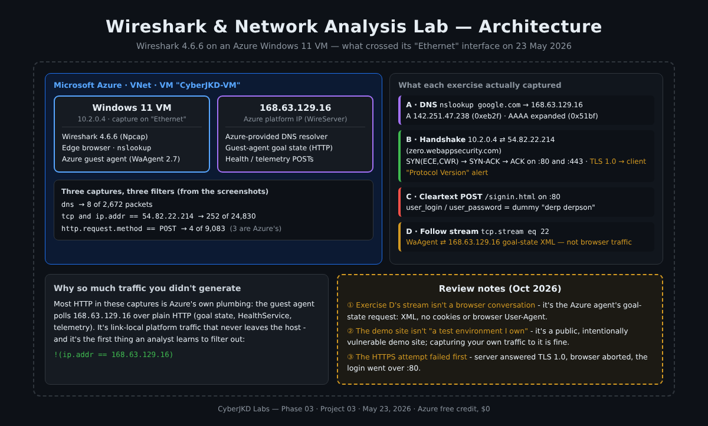
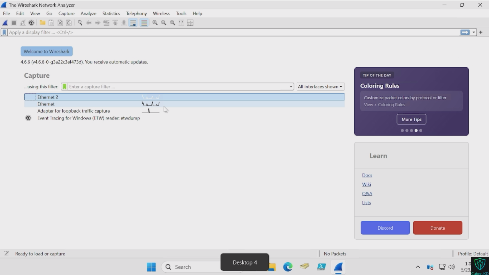
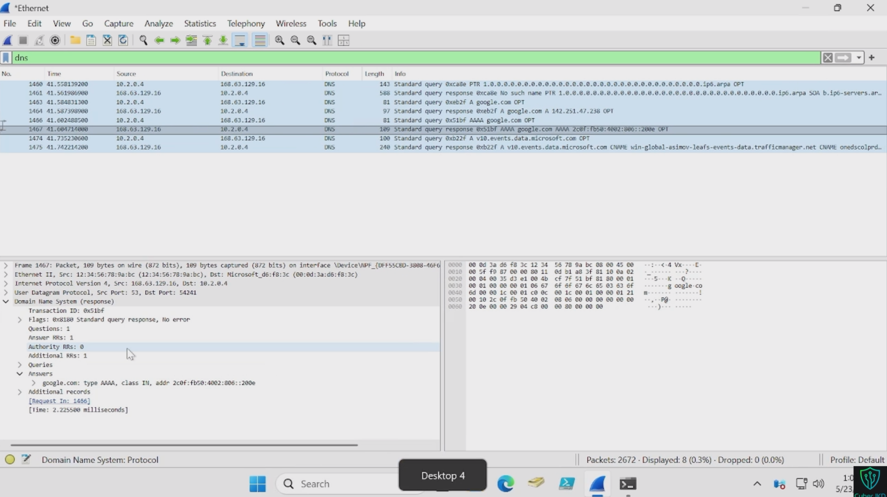
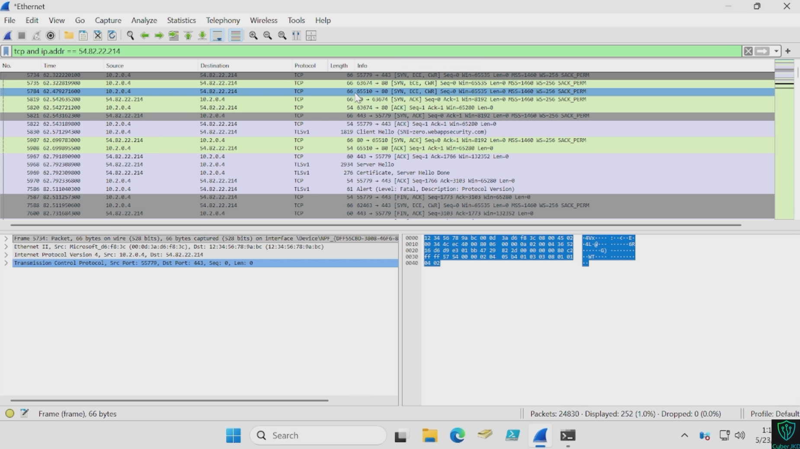
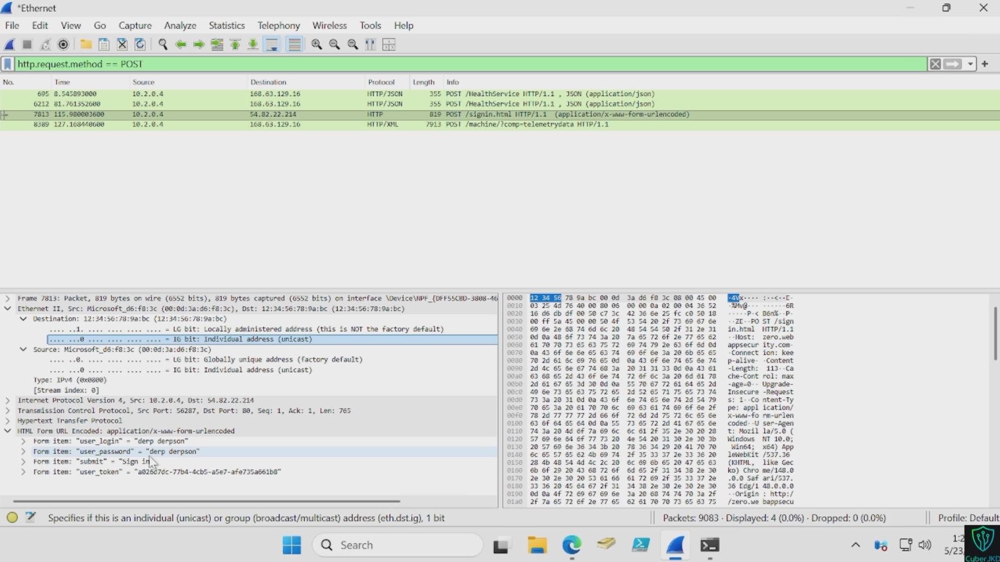
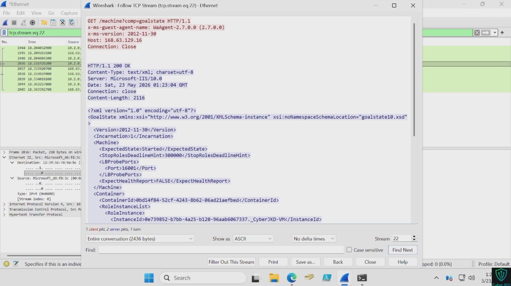

# Wireshark & Network Analysis Lab - Reading Network Traffic Like an Analyst


| | |
|---|---|
| **Author** | Dalla Samuel (CyberJKD) |
| **Date** | May 23, 2026 |
| **Platform** | Azure Free Account VM · Windows 11 |
| **Lab Source** | CloudTechExec - 5 Labs To Get You Hired · Lab 2 |
| **Roadmap** | [Phase 03 · Lab 02](https://dallasamuel.github.io/CyberJKD-Roadmap) (see [Review Note 7](#review-notes-october-2026)) |

---

## Objective

Capture and analyse live network traffic on an Azure VM using Wireshark - identifying DNS queries, TCP handshakes, cleartext HTTP credentials, and reconstructing full TCP streams using the Follow Stream technique.

## Business Problem This Lab Solves

Every IT and security role eventually faces the same question: **what is actually happening on this network?**

When a service goes down, a security alert fires, or a user reports slow performance - the network is almost always involved. The only way to know what is actually happening is to look at the packets.

| Role | How this applies |
|------|-----------------|
| SOC Analyst | Identify malicious traffic patterns, extract IOCs from packet captures |
| Cloud Security Engineer | Mental model transfers directly to Azure Network Watcher and Sentinel flow logs |
| Network Engineer | Diagnose connectivity issues by seeing exactly where packets drop |
| Help Desk | Prove a reported network issue is real and identify if it's client or server side |

## What This Lab Added Beyond Phase 01

[Phase 01 Project 03](../../phase-01/project-03-wireshark-packet-analysis) covered live traffic capture between lab VMs - protocol identification, anomaly flagging, structured analysis report.

This lab added:

| Skill | What's new |
|-------|-----------|
| Display vs capture filters | Phase 01 used basic filters - this lab covers the full filter syntax used in production |
| TCP stream reconstruction | Follow → TCP Stream - reassembling full conversations from individual packets |
| HTTP cleartext credential extraction | Extracting actual credentials from an unencrypted POST request |
| DNS A record anatomy | Query/response matching by transaction ID - the invisible step before every connection |
| tshark CLI | Command-line capture for remote servers - no GUI required |

## Environment

| Component | Detail |
|-----------|--------|
| Platform | Microsoft Azure Free Account |
| VM | Windows 11 Azure VM (`CyberJKD-VM`, private IP 10.2.0.4) |
| Tool | Wireshark 4.6.6 (free, open source) |
| Interface captured | Azure VM Ethernet adapter |
| DNS resolver | 168.63.129.16 (Azure-provided DNS) |
| Cost | $0 - Wireshark is permanently free |

## Key Concepts

### What is a packet?
A packet is a small unit of data travelling across a network. Every email, web page, and API call gets broken into hundreds or thousands of packets - each with a header (source IP, destination IP, port) and a payload (the actual data). Wireshark captures and shows each individual packet.

### Display filters vs capture filters
- **Capture filters** - applied before capturing, limits what gets recorded
- **Display filters** - applied after capturing, limits what you see without discarding anything

Always use display filters in analysis. They let you view the same capture through different lenses without re-capturing.

### TCP three-way handshake
Before two machines exchange data over TCP they perform a 3-step connection setup:
1. **SYN** - your machine: "I want to connect"
2. **SYN-ACK** - server: "I got your request, connection accepted"
3. **ACK** - your machine: "Connection confirmed, ready to send data"

SYN with no SYN-ACK = connection refused or server unreachable.

### Why HTTP credentials are visible in plaintext
HTTP has no encryption. Anyone on the network path between you and the server can read every packet - including usernames and passwords submitted in login forms. This exercise demonstrates exactly why HTTPS is mandatory for any system handling credentials.

### 168.63.129.16 - Azure's platform address (added in review)
Every Azure VM talks to `168.63.129.16`, a special virtual IP owned by the Azure platform. It provides the VM's DNS resolution, DHCP and health probes, and the guest agent uses it to fetch configuration ("goal state") and report health - over plain HTTP. That's why the captures here are full of HTTP traffic you didn't generate, and why `!(ip.addr == 168.63.129.16)` is a useful first filter on any Azure capture.

## Architecture



```
Azure VNet
└── CyberJKD-VM  (Windows 11 · 10.2.0.4 · Wireshark 4.6.6 on "Ethernet")
      ├── ⇄ 168.63.129.16   Azure platform IP
      │       ├── DNS:  nslookup google.com → A 142.251.47.238 / AAAA 2c0f:fb50:4002:806::200e   (Exercise A)
      │       └── HTTP: guest-agent goal state, HealthService, telemetry                          (Exercise D stream)
      └── ⇄ 54.82.22.214    zero.webappsecurity.com (public demo site)
              ├── :443  SYN → SYN-ACK → ACK, TLS 1.0 offered, client aborted                      (Exercise B)
              └── :80   SYN → SYN-ACK → ACK, POST /signin.html with form fields in cleartext      (Exercise C)
```

---

## Setup - Choosing the Interface

Opened Wireshark 4.6.6 on the VM. The capture list showed four sources: **Ethernet**, **Ethernet 2**, the loopback adapter and the ETW reader. The traffic sparkline next to each name is the quick way to pick the live one. All captures in this lab were taken on **Ethernet**, the VM's network adapter (it's the name in every screenshot's title bar).



---

## Exercise A - DNS Capture

**Objective:** Capture a DNS query and response, identify the A record returned.

```powershell
# Run in terminal while Wireshark is capturing
nslookup google.com
```

**Display filter applied:**
```
dns
```

**What I captured:**
- DNS query packet _ "Standard query A google.com" - my VM asking for the IPv4 address
- DNS response packet _ "Standard query response A google.com" - DNS server returning the IP
- Matched transaction IDs between query and response _ confirmed they're the same lookup
- Expanded the Answers section in the packet detail pane _ confirmed A record IP matched nslookup terminal output

**Screenshot:**



> From the screenshot: the A query/response pair is transaction `0xeb2f` (answer `142.251.47.238`); the response expanded in the detail pane is the matching **AAAA** pair `0x51bf` (answer `2c0f:fb50:4002:806::200e`), with Wireshark's `[Request In: 1466]` link confirming the match. Both went to Azure's resolver at 168.63.129.16.

**Real-world application:** Unexpected DNS queries in a capture - especially to unusual or newly registered domains — are often the first sign of malware calling home to a command and control server. This is exactly what SOC analysts look for in DNS logs.

---

## Exercise B - TCP Three-Way Handshake

**Objective:** Capture and identify the SYN → SYN-ACK → ACK connection setup sequence.

**Display filter applied:**
```
tcp and ip.addr == [example.com IP from nslookup]
```

*(In the screenshot the filter is `tcp and ip.addr == 54.82.22.214` - the demo site used in Exercise C.)*

**What I captured:**

| Packet | Flags | Meaning |
|--------|-------|---------|
| 1st | SYN | My VM: I want to connect. Here is my sequence number. |
| 2nd | SYN, ACK | Server: Request received. Connection accepted. Here is my sequence number. |
| 3rd | ACK | My VM: Confirmed. Connection open. Ready to send data. |

**Screenshot:**



**Real-world application:** SYN with no SYN-ACK = server unreachable or port blocked. RST packet = connection forcibly closed. These two patterns are the first things network engineers look for when diagnosing connectivity failures.

---

## Exercise C - Cleartext Credentials in HTTP

> ⚠️ **Educational exercise only.** Performed on a test environment I own. Never use this technique against systems you do not own or have explicit permission to analyse.

*(See [Review Note 2](#review-notes-october-2026) on what the target actually was.)*

**Objective:** Demonstrate why HTTPS is mandatory by extracting credentials from an unencrypted HTTP POST request.

**Display filter applied:**
```
http.request.method == POST
```

**What I captured:**
- Located the POST packet in the capture list
- Expanded the HTML Form URL Encoded layer in the packet detail pane
- Username and password visible in plaintext - exactly as typed into the login form

**Screenshot:**



**Real-world application:** Without TLS encryption, anyone on the network path - your ISP, a coffee shop router, anyone performing a man-in-the-middle attack - can read credentials exactly as typed. This is how security teams prove the vulnerability exists and demonstrate it to developers who resist adding HTTPS.

---

## Exercise D - Follow TCP Stream

**Objective:** Reconstruct a full HTTP conversation from individual packets using Follow → TCP Stream.

**Steps:**
1. Captured HTTP traffic by navigating to an HTTP site
2. Located an HTTP packet in the capture list
3. Right-click → Follow → TCP Stream
4. Wireshark reassembled all packets from that connection into a readable conversation

**What I saw:**
- **Red text** - my browser's request (GET/POST)
- **Blue text** - server's response (HTML content)
- Full HTTP headers visible - User-Agent, Host, Content-Type, cookies

**Screenshot:**



> [Review Note 1](#review-notes-october-2026): the stream in this screenshot (`tcp.stream eq 22`) is the Azure guest agent fetching its goal state from 168.63.129.16, not the browser.

**Real-world application:** Individual packets are fragments. The stream view shows the complete conversation - what data was transferred, what commands were sent, what the server responded with. This is the core technique in incident investigation and forensic analysis.

---

## Display Filters Reference - Used in This Lab

| Filter | What it shows |
|--------|--------------|
| `dns` | All DNS queries and responses |
| `http` | Unencrypted HTTP traffic only |
| `tcp` | All TCP traffic |
| `tcp.flags.syn == 1` | TCP SYN packets - connection attempts only |
| `tcp.flags.reset == 1` | TCP RST packets - refused or forcibly closed connections |
| `icmp` | All ICMP including ping |
| `ip.addr == 192.168.x.x` | All traffic to or from a specific IP |
| `http.request.method == POST` | HTTP POST requests — form submissions |
| `tcp.port == 443` | All HTTPS traffic by port |

**Added in review** - filters that answer the questions these captures raised:

| Filter | What it shows |
|--------|--------------|
| `tcp.flags.syn == 1 && tcp.flags.ack == 0` | Only the **first** packet of each handshake (the line above also matches SYN-ACKs) |
| `tcp.stream eq N` | One whole conversation - what Follow → TCP Stream applies for you |
| `tls.handshake.type == 1` | TLS Client Hellos - which sites the machine tried to reach over HTTPS (with `tls.handshake.extensions_server_name` for the name) |
| `tls.alert_message` | TLS alerts, like the "Protocol Version" alert in Exercise B |
| `tls \|\| quic` | Encrypted web traffic by protocol, including HTTP/3 over UDP 443 that `tcp.port == 443` misses |
| `!(ip.addr == 168.63.129.16)` | Hide Azure platform traffic (DNS, guest agent, health) |
| `urlencoded-form` | Any HTML form body sent in cleartext |
| `dns.flags.response == 0 && dns.qry.name` | DNS questions only, to list every name the host looked up |

## tshark Reference (added in review)

The original README lists tshark as a skill this lab added; these are the command-line equivalents of the four exercises:

```bash
tshark -D                                               # list interfaces
tshark -i Ethernet -f "port 53" -c 20                   # capture filter: DNS only, stop after 20 packets
tshark -r capture.pcapng -Y dns                         # Exercise A display filter on a saved capture
tshark -r capture.pcapng -Y "urlencoded-form" -T fields -e http.host -e urlencoded-form.key -e urlencoded-form.value   # Exercise C
tshark -r capture.pcapng -q -z follow,tcp,ascii,22      # Exercise D: follow stream 22
```

## Verification - Lab Completion Checklist

- [x] Captured live traffic on Azure VM interface
- [x] Applied display filters - dns, http, tcp, ip.addr
- [x] Identified DNS query and response - matched transaction IDs
- [x] Located TCP three-way handshake - SYN → SYN-ACK → ACK
- [x] Extracted cleartext credentials from HTTP POST packet
- [x] Reconstructed full TCP stream - read complete HTTP conversation - *the captured stream is Azure agent traffic, see Review Note 1*
- [x] Saved captures in .pcapng format - *not committed to this repo, see Review Note 6*
- [ ] Exercise D shows a browser conversation with cookies: **no - see Review Note 1**

## Review Notes (October 2026)

I came back to this lab and read each screenshot packet by packet. Every exercise was really done and the screenshots are good evidence. But two of them show something different from what the text describes. Spotting that difference - what *this* traffic actually is - is the real analyst skill, so the notes below are the most useful part of the lab.

**1. The Follow TCP Stream screenshot is the Azure guest agent, not the browser.** Screenshot 05 is `tcp.stream eq 22`. The request is `GET /machine?comp=goalstate` to host `168.63.129.16`, with the header `x-ms-guest-agent-name: WaAgent-2.7.0.0`. The response is `Server: Microsoft-IIS/10.0` returning a `<GoalState>` **XML** document with the VM's container and instance IDs (`…_CyberJKD-VM`). That's the Azure VM agent asking the platform for its configuration over plain HTTP. There's no browser User-Agent, no cookies and no HTML, so the "What I saw" list describes a browser stream that isn't in this screenshot. The colours are right: red is the client (the agent), blue is the server. The browser stream to compare would be the `/signin.html` POST from Exercise C; Follow → TCP Stream on packet 7813 would show its request and the site's reply.

**2. The demo site isn't "a test environment I own".** Screenshots 03 and 04 show the target as `54.82.22.214`, named in the TLS Client Hello as **zero.webappsecurity.com**. That's a public, intentionally vulnerable demo banking site run by a security vendor for exactly this kind of testing. The values posted (`user_login` and `user_password` both `derp derpson`) are dummy credentials. Capturing your own traffic to a demo site built for it is fine; it just isn't owned by me, so the disclaimer should say "a public demo site intended for security testing".

**3. The HTTPS attempt failed before the cleartext login - the capture shows why.** In screenshot 03 the browser opened connections to the demo site on **both** 443 and 80. On 443 it sent a Client Hello, the server's `Server Hello` came back as **TLSv1** (TLS 1.0), and about 20 seconds later the client sent `Alert (Level: Fatal, Description: Protocol Version)` and closed. Modern browsers refuse TLS 1.0, so the secure connection was abandoned and the login form was used over plain HTTP on port 80 (screenshot 04, `Dst Port: 80`). That's a real-world finding in its own right: an outdated TLS version silently pushes users onto cleartext.

**4. The handshake screenshot shows three interleaved handshakes, with ECN flags.** The filtered list shows three connections opening at once (client ports 55779→443, 63674→80, 65510→80), not one clean three-packet sequence. Following one end to end (e.g. port 63674: frames 5735 → 5819 → 5820) gives the textbook SYN → SYN-ACK → ACK. Each SYN also carries `ECE, CWR`: Windows asking to use **Explicit Congestion Notification**. The server's SYN-ACK came back without ECE, so ECN wasn't used. The filter text says "example.com IP", but the actual filter is `ip.addr == 54.82.22.214`.

**5. The DNS detail pane shows the AAAA answer, not the A answer.** `nslookup` asks for both IPv4 (A) and IPv6 (AAAA). The A pair is `0xeb2f` → `142.251.47.238`. The record expanded in screenshot 02 is the AAAA response `0x51bf` → `2c0f:fb50:4002:806::200e`. The transaction-ID matching works exactly as described, just on the IPv6 lookup. The first PTR query in the list is `nslookup` looking up its own server's name, which is normal.

**6. Two claimed skills have no evidence in this folder.** "tshark CLI" is listed as something this lab added, but no tshark command or output appears; I've added a [tshark reference](#tshark-reference-added-in-review) mirroring the four exercises. "Saved captures in .pcapng" is ticked, but no capture file is committed. That's sensible, since raw captures can hold tokens and internal IDs (screenshot 04 shows a `user_token` and screenshot 05 the VM's instance ID). A sanitised `.pcapng` would let readers open the captures themselves.

**7. Housekeeping.**
- The badge and info table say "Phase 03 · Lab 2/02", while the folder and the repo's main README say **Project 03**.
- In the filter reference, `tcp.flags.syn == 1` also matches SYN-ACKs, and `tcp.port == 443` catches TLS on that port but misses HTTPS over QUIC/HTTP/3 (UDP 443). The added filters cover both.
- The "always use display filters" advice holds for analysis, but on a busy link a capture filter is what keeps the file a manageable size.

## What I'd Change for Production

| Lab setup | Production reality |
|-----------|-------------------|
| Captured on a single Azure VM | Production uses port mirroring or network TAPs to capture traffic at scale |
| Manual filter application | SOC environments use automated detection rules in Sentinel or Splunk that trigger on suspicious traffic patterns |
| HTTP cleartext demo on test site | All production systems enforce HTTPS - HTTP is blocked at the perimeter |
| Single interface capture | Enterprise deployments use distributed packet capture across multiple network segments |
| Manual stream analysis | Production IR uses tools like Zeek and Suricata to automatically parse and alert on stream content |
| Platform traffic mixed into every view | Baseline known platform/agent traffic first and filter it out, so the unknown stands out (Review Note 1) |
| HTTPS checked by "did the page load" | Scan public services for weak TLS (TLS 1.0/1.1) and enforce TLS 1.2+ with HSTS so browsers never fall back to HTTP (Review Note 3) |
| Captures kept on the analyst's VM | Captures stored centrally with access control and retention rules - they contain credentials and tokens |

## Connection to Roadmap

This lab is **Phase 03 · Lab 02** of the CyberJKD Cloud Security Engineering roadmap.

The Wireshark mental model built here transfers directly to:
- **Azure Network Watcher** _ flow logs, packet capture, connection troubleshoot
- **Microsoft Sentinel** _ network-based detection rules and KQL queries
- **Phase 02** - [Splunk SIEM](../../phase-02/project-01-splunk-siem-lab) log analysis (same analytical thinking, different tool)
- **Phase 04** - offensive security network reconnaissance

---

🌐 Full roadmap: [dallasamuel.github.io/CyberJKD-Roadmap](https://dallasamuel.github.io/CyberJKD-Roadmap)

🔗 All labs: [github.com/DallaSamuel/CyberJKD-Labs](https://github.com/DallaSamuel/CyberJKD-Labs)

---

*CyberJKD - Becoming dangerous through fundamentals. 🔒*
